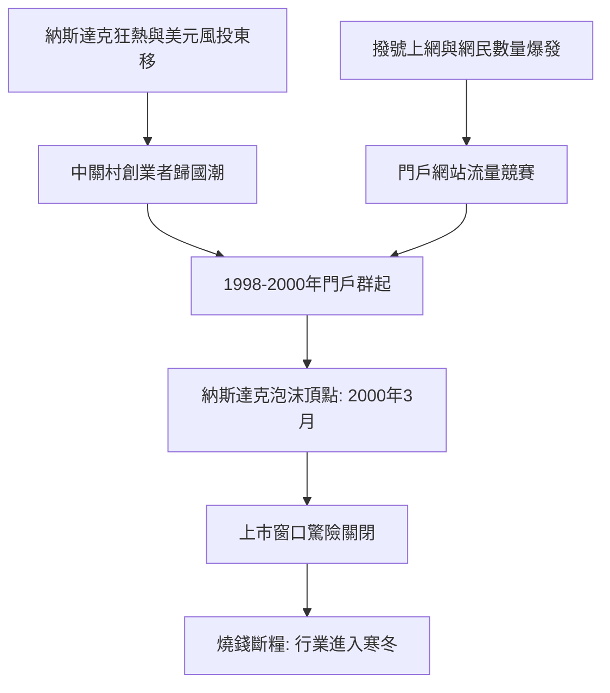

# 3.2 1998-2000年網路泡沫與門戶網站

1990年代末，美國網際網路熱潮傳入中國，中關村率先承接。1996年前後，剛從美歐歸國的創業者聚集海淀；1998年，新浪由四通利方與北美華淵網合併而成，搜狐的前身愛特信已成立兩年，網易雖立足廣州卻也把重心移向北京；同年騰訊在南方誕生，而以中關村為大本營的門戶與社區構成了中國網路的第一梯隊。1999年，中國黃頁出身的馬雲團隊北上未果，又從另一面印證了智力與資本資源在北京的集中。中關村出現了最早的咖啡館路演、獵頭與風險投資辦公室。

驅動這一輪狂熱的機制是美國資本市場的傳導：納斯達克指數自1998年底起約18個月內翻倍以上，中國概念股的估值天花板被大幅抬高。設公司價值 $V$ 與用戶數 $U$ 掛鉤，當時流行的估值邏輯近似

$$V = m \cdot U^{1.2}$$

其中 $m$ 為資本市場情緒係數。2000年3月納斯達克見頂後 $m$ 急劇收縮，新浪、搜狐、網易在泡沫破滅邊緣上市，股價一度跌破發行價，燒錢模式幾乎斷糧。

**因果分析**：門戶時代的因果結構是「外部資本定價、內部流量競賽」。美國泡沫既是孵化器也是炸彈：沒有納斯達克估值示範，新浪搜狐拿不到融資；正是同樣的泡沫，在2000年後讓它們上市即破發、被迫在寒冬中轉型。中關村在此輪中的位置比深圳廣州更靠「內容與媒體」，因為門戶需要新聞資質、編輯人才與政商網絡，這些恰是北京相對南方城市的比較優勢。泡沫破滅淘汰了跟風者，卻把倖存者逼向盈利模式創新——短信用戶付費、網路遊戲、廣告競價——為2003年後的第二波上漲埋下伏筆。泡沫的因果意義，是用透支的未來提前完成了基礎設施與用戶教育。

## 參考要點
- 門戶選址北京是監管與人才稟賦的結果。
- 泡沫同時供給資本與毀滅，倖存者獲得轉型窗口。
