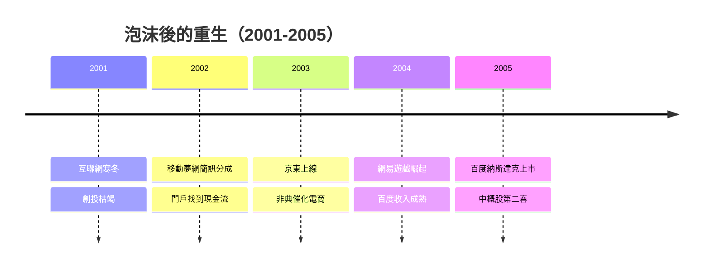

# 3.3 泡沫破滅後的汰選與重生

2001-2004年是中關村互聯網的殘酷汰選期。門戶網站靠中國移動夢網的簡訊分成與網路遊戲找到收入模型：網易憑藉《大話西遊》等遊戲起死回生，2003年丁磊一度成為中國首富；搜狐、新浪以無線增值與廣告恢復盈利，股價從谷底反彈數十倍。與此同時，一批新公司開始生長：2003年成立的京東原本只是中關村櫃檯上的光磁產品代理商，非典疫情倒逼其上線電子商務；百度於2000年成立後潛伏五年，2004年前後以競價排名模式完成商業閉環，2005年8月在納斯達克上市首日暴漲逾350%。

## 因果分析

汰選與重生的因果結構在於：泡沫破裂（前因）強制行業從「流量敘事」轉向「收入敘事」（機制），進而催生出簡訊、遊戲、搜索競價等可收費模式（後果）。驅動關係上，電信運營商的計費管道（夢網）意外成為互聯網的收費基礎設施，說明了產業重生依賴於既有壟斷者的開放程度。非典疫情則以物理隔離的方式完成了一次電子商務的全民試用，是典型的外部衝擊型催化劑。經過此輪汰選，中關村從「攢機一條街」升級為「互聯網公司總部聚集地」，產業能級完成第一次躍遷。

[下一節：4.1 中關村西區與創業大街的空間重塑](04.1-中關村西區與創業大街的空間重塑.md)
