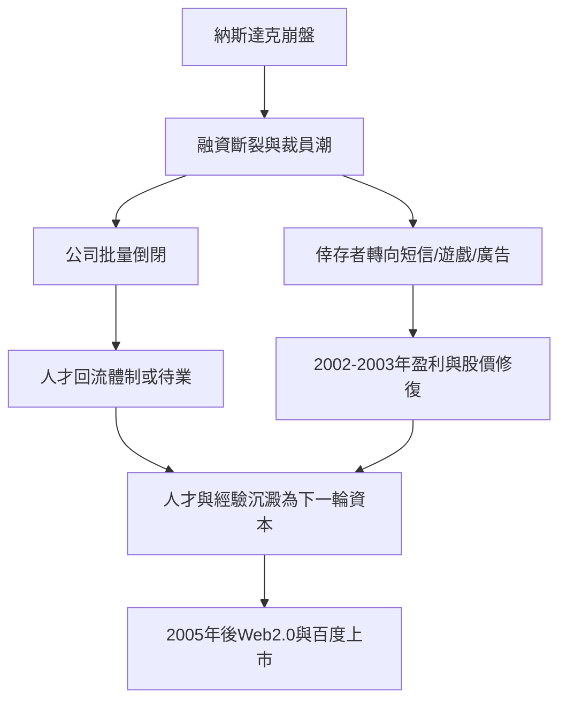

# 3.3 泡沫破滅後的淘汰與重整

2000年3月納斯達克崩盤，全球網路股蒸發數兆美元市值，中國門戶股價普遍跌至一美元上下，面臨摘牌風險。中關村的網路公司批量倒閉：辦公室退租、裁員、媒體從追捧轉為嘲諷，「.com」一度成為貶義詞。但寒冬同時是一場殘酷而高效的篩選。新浪、搜狐、網易在2002年前後依靠短信增值服務實現盈利——每條彩信短信的分賬收入 $r$ 乘以用戶數 $U$，構成了第一個被驗證的商業模式

$$\Pi = (r - c)\,U - F$$

其中 $c$ 為通道成本、$F$ 為固定成本。當 $U$ 隨手機普及爆炸式增長，$(r-c)U$ 迅速覆蓋 $F$，公司由燒錢轉為盈利，股價在2003年回升數十倍。

寒冬的空間後果同樣重要：倒閉公司釋放出大量熟悉網路營運的工程師與產品經理，廉價辦公空間與失業人才在中關村沉澱，成為下一輪創業的燃料。同時，泡沫期建設的IDC機房、寬頻主幹與上網人口留存下來，構成基礎設施遺產。

**因果分析**：淘汰與重整構成一個完整的生態循環：繁榮期過度投資→崩盤→資源賤賣與人才釋放→低成本環境孕育新創業→下一輪繁榮。百度2000年成立於中關村、2005年8月在納斯達克上市首日大漲，正是利用了寒冬留下的廉價人才與已教育好的網民市場。對比1988年試驗區用政策確認自發聚集、2000年用市場出清完成代謝，中關村的生態系逐漸學會了兩種更新機制並用：行政確認與市場淘汰。這種雙軌更新，是它與單純政策園區的根本區別。

## 參考要點
- 短信模式是中國網路第一個規模化盈利路徑。
- 危機的空間遺產：人才、經驗與基礎設施的賤價沉澱。
