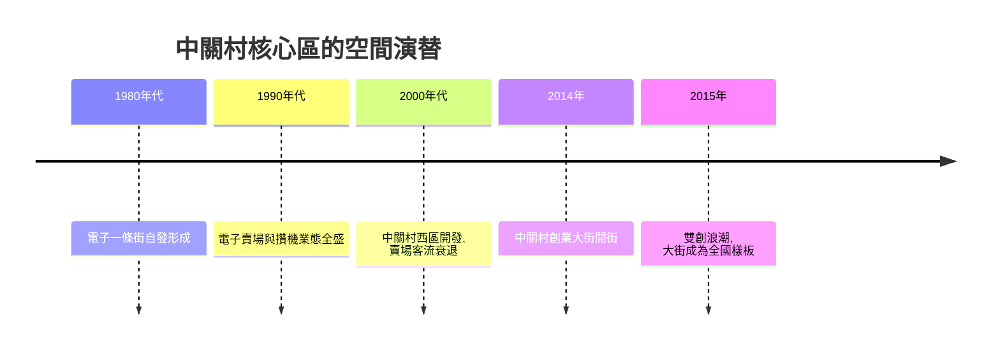

# 4.1 中關村西區與創業大街的空間再造

2000年代，中關村的核心區啟動西區開發：在原電子一條街北側建設地下城與高層樓群，引入資本、金融與大型企業總部，電子賣場逐步外遷。傳統的「攤販式」電子市場（海龍、鼎好、中發）在電子商務衝擊下客流萎縮，政府順勢推動空間功能置換。2014年6月，海龍對面的圖書城步改造為「中關村創業大街」，聚集車庫咖啡、3W咖啡、創業苗圃與投資機構，宣示中關村從「賣電腦的街」轉型為「賣夢想的街」。2015年「大眾創業、萬眾創新」口號提出後，大街成為全國雙創的圖騰。

空間再造背後是地租與功能的雙重演替。設街區用地在電子零售用途下的地租產出為 $R_1$，在科技金融與創新服務用途下為 $R_2$，當

$$R_2 - R_1 > C_{\text{置換}}$$

即轉換收益超過改造成本時，功能置換便會發生。電子商務對線下賣場的打擊壓低了 $R_1$，政府補貼降低了 $C_{\text{置換}}$，兩者共同觸發了大街的誕生。

**因果分析**：空間再造的因果鏈是：電子商務壓垮線下零售→賣場地租預期下降→政府與產權方推動功能置換→創業服務業態進駐→政策放大效應（雙創）→全國複製。值得注意的是因果的方向性：不是規劃創造了創業，而是舊業態的衰亡騰出了空間，規劃只是把這一騰退制度化並賦予象徵意義。創業大街本身的商業成績有限——車庫咖啡裡真正跑出的大公司並不多——但它的符號產出巨大：它把「創業」從個人冒險重新定義為被社會尊敬的職業選擇，這種觀念資本反哺了2010年代的人才流動。

## 參考要點
- 空間演替遵循地租差與置換成本的經濟邏輯。
- 大街的價值主要在符號與觀念，而非項目成功率。
