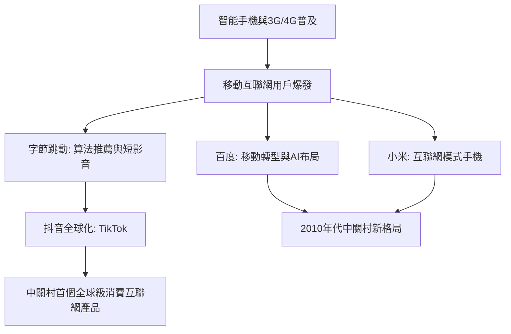

# 4.2 移動互聯網與百度、字節跳動

2010年前後，智能手機與3G普及開啟移動互聯網浪潮，中關村再次占據潮頭。百度2000年成立於中關村，憑搜索競價排名在PC時代確立霸主地位，並在2010年後圍繞移動搜索、地圖、O2O全面轉型；小米2010年在中關村銀谷大廈創立，以互聯網模式重做手機；2012年3月，張一鳴在錦秋家園創立字節跳動，先做內涵段子與今日頭檔，2016年推出抖音，以推薦算法重塑信息分發。頭條與抖音的算法內核可以概括為對點擊率的貝葉斯式估計與排序

$$\hat{p}(c \mid u, i) \approx \frac{n(c,u,i) + \alpha}{n(u,i) + \alpha + \beta}$$

再按 $\hat{p}$ 加權預期停留時長分發內容，實現了內容與用戶的毫秒級匹配。

移動浪潮的競爭邏輯與PC時代不同：獲取用戶的成本 $C_{\text{獲客}}$ 決定生死，當用戶終身價值滿足

$$\mathrm{LTV} = \sum_{t} \frac{ARPU_t}{(1+r)^t} > C_{\text{獲客}}$$

時燒錢換量即為理性。字節跳動正是把算法效率轉化為 LTV/CAC 比率的機器。

**因果分析**：移動互聯網浪潮的因果根基仍是海淀的智力密度——推薦系統、計算廣告與深度學習需要大量算法工程師，北京高校與研究院所持續供給這類人才。字節跳動的崛起揭示了一個新規律：技術優勢從「硬體與渠道」轉向「數據與算法」。與百度依賴搜索入口、小米依賴硬體性價比不同，字節跳動把組織本身設計成 A/B 測試流水線，使產品迭代速度成為壁壘。抖音的成功又驅動資本、人才與政策進一步向中關村傾斜，完成又一次「成功案例→資源聚集→更多成功案例」的正反饋，與1984年的四通聯想邏輯同構，只是載體從漢卡換成了算法。

## 參考要點
- 字節跳動是中關村智力密度在算法時代的兌現。
- 移動時代勝負手由渠道轉向數據反饋速度。
