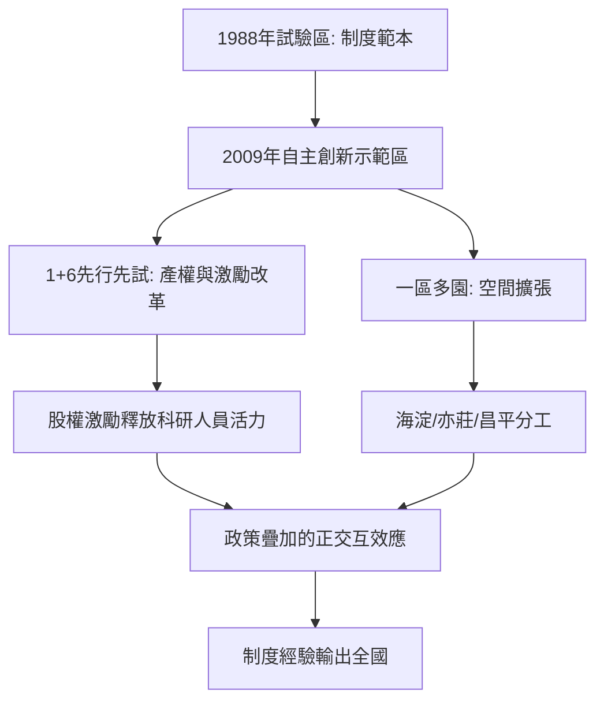

# 4.3 政策疊加：自主創新示範區

2009年3月，國務院批准建設「中關村國家自主創新示範區」，將1988年的試驗區升格為全國首個自主創新示範區，覆蓋海淀、昌平、亦莊等「一區多園」格局。2010年底至2011年，中關村獲准先行先試「1+6」政策：科技成果處置權下放、股權激勵、科研經費管理改革、高新技术企业認定簡化等，多項制度突破在「十二五」期間向全國推廣。2013年，中關村成為全國首個國家級人才特區的承載地，「千人計劃」歸國創業者大量落地；2014-2015年，創業大街與雙創政策再添一層。政策呈現罕見的「疊加」狀態：同一片土地上同時疊著示範區、自貿區、人才特區與金融改革試點。

政策疊加的效果可用政策強度對企業成長率的作用粗略刻畫。若企業基礎成長率為 $g_0$，第 $i$ 項政策帶來的增益為 $\delta_i$，且政策間存在交互項，則

$$g = g_0 + \sum_i \delta_i + \sum_{i<j} \delta_{ij}$$

正的交互項 $\delta_{ij}$（如股權激勵與人才引進的協同）是疊加政策的真正價值所在。

**因果分析**：這一輪政策疊加的因果起點，是2008年金融危機後國家對「依靠創新驅動增長」的緊迫感：出口導向模式受挫，北京作為智力高地被賦予率先試錯的任務。因果的關鍵環節在於產權改革——科技成果的處置權與收益權下放，直接改變了教授與研究員創辦公司的激勵結構，此前「成果屬單位、轉化有風險」的死結被打開。這解釋了為何2010年代高校系創業（如多個AI團隊從院所走出）明顯增多。但政策疊加亦有代價：多層級政策的申報成本、示範指標的短期化壓力，可能誘導「政策套利型」企業。中關村的經驗顯示，政策有效性取決於交互項與市場機制的相容性，而非政策數量本身。

## 參考要點
- 產權與激勵改革是疊加政策中槓桿率最高的一項。
- 政策疊加存在收益遞減與套利風險。
