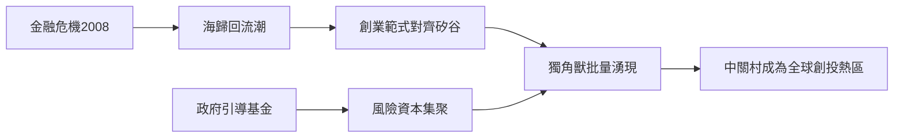

# 4.3 海歸回流與風險資本的集聚

2008年金融危機後，歐美就業市場收縮而中國逆勢擴張，觸發大規模人才回流。中關村是最大受益者：2009年推出「中關村高端人才領軍工程」，2011年中組部「千人計劃」在中關村落地的入選者數量居全國各園區之首。海歸帶回的不僅是技術，更是標準化的創業範式——股權結構、員工期權（ESOP）、A輪/B輪融資路徑，使中關村的創業方法論與矽谷逐漸對齊。

風險資本同步集聚：IDG、紅杉、經緯等美元基金在北京設點，君聯資本（聯想系）等人民幣基金興起；中關村管委會推動的天使引導基金與「金種子工程」則以政府信用槓桿撬動社會資本。創投金額與案例數在2014-2015年達到階段性頂峰。

## 因果分析

海歸與創投的集聚是典型的「雙向驅動」：危機與中國市場機會的剪刀差造成人才回流（前因），回流人才的可預期性降低了投資風險，吸引資本跟進（機制），資本充沛又進一步吸引下一批人才與項目（後果），形成正回饋環。政府引導基金在環節初期發揮了信號作用，但也帶來補貼依賴與估值虛高的副作用。此階段的深遠後果是：中關村從「政策試驗區」升級為「自我維持的創新生態」，人才、資本與專案可以在體系內部閉環流轉——這一能力，正是下一階段AI浪潮能在此爆發的土壤。

[下一節：5.1 字節跳動與移動互聯網的頂點](05.1-字節跳動與移動互聯網的頂點-2015-2026.md)
