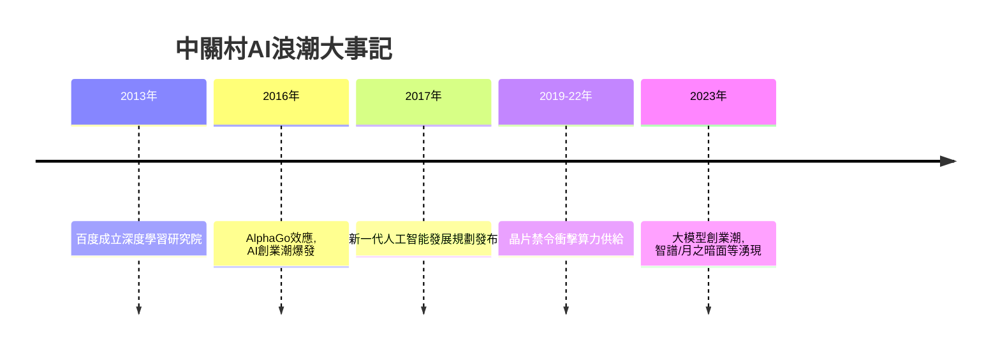

# 5.1 人工智慧浪潮與北京智力密度

2010年代中期起，深度學習的突破把人工智慧推向產業前沿，而中關村幾乎是這場浪潮在中國的原點。中科院自動化所、計算所長期積累的模式識別與語音研究，清華、北大的機器學習團隊，加上百度2013年成立的深度學習研究院，共同構成人才蓄水池。2016年AlphaGo擊敗李世石後，AI創業潮爆發：商湯、曠視、依圖、雲從等計算機視覺公司獲得巨額融資，其中曠視即誕生於清華園的創業團隊。2017年國務院印發新一代人工智能發展規劃，北京成為AI企業與論文產出最密集的城市。2023年起，大模型浪潮再起，中關村湧現智譜、月之暗面、百川智能等「AI六小虎」式新創企業，均以海淀為基地。

AI競爭的核心投入是算力、數據與人才三要素，其生產函數可寫為

$$Y = A \cdot K^{\alpha} D^{\beta} H^{\gamma}, \quad \alpha+\beta+\gamma > 1$$

其中 $K$ 為算力資本、$D$ 為數據、$H$ 為研究人才，規模報酬遞增的假設解釋了為何領先者優勢不斷擴大。中關村在 $H$ 維度上的優勢最為突出。

**因果分析**：AI浪潮的因果結構是四十年智力密度的一次總兌現。回看因果鏈：太監墳場的空地→學院路與中科院的聚集→1980年代下海→算法與數據產業→深度學習人才池→大模型創業。每一環都以前一環為前提。但外部約束同樣在因果鏈中：2019年起的美國晶片出口管制直接壓縮了 $K$ 維度的供給，迫使中關村企業在受限算力下優化算法效率，並催生國產AI晶片的替代需求。這種「約束下的創新」重塑了AI產業的技術路線：從堆算力轉向模型效率、數據質量與垂直場景。智力密度依然是中關村最大的資產，但它兌現的條件，越來越取決於地緣政治所決定的算力邊界。

## 參考要點
- AI是中關村四十年智力積累的路徑依賴性兌現。
- 晶片約束把競爭從算力規模引向算法效率。
