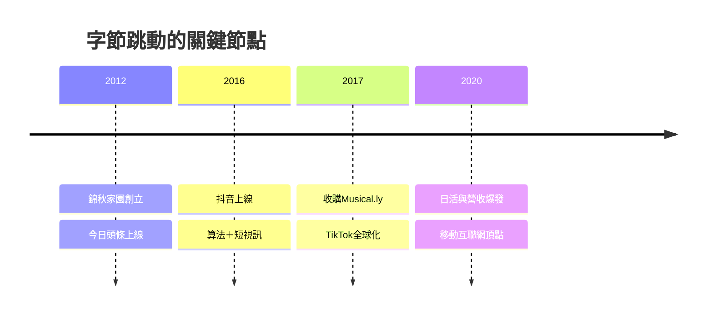

# 5.1 字節跳動與移動互聯網的頂點

2012年，張一鳴在知春路的錦秋家園民宅中創立字節跳動。當巨頭仍在門戶與搜索邏輯中徘徊時，字節跳動以「算法分發取代人工編輯」為核心假設，先做今日頭條，再於2016-2017年先後推出抖音與海外版TikTok。推薦算法與短視訊的結合命中了移動互聯網的最大公約數：注意力。到2020年前後，抖音日活突破六億，TikTok成為首款真正全球化的中國應用，字節跳動估值一度超過數千億美元，成為中關村產出的市值最高的私營公司。

## 因果分析

字節跳動的崛起有其結構性前因：移動用戶紅利見頂前的最後一波注意力遷移、4G資費下降使視訊消費可行、以及中關村多年積累的算法工程師人才池。其驅動機制是「數據—算法—留存」的增長飛輪：用戶停留越久，數據越多，推薦越準，停留更久——這是一個自我強化的正回饋系統。後果具有雙面性：一方面證明了中關村能夠孕育超越上一代巨頭的公司，完成產業領導權的代際交替；另一方面，算法分發引發內容治理、成癮與地緣政治（TikTok在美國遭遇審查）等新問題，預示著科技企業的社會成本開始進入定價。

[下一節：5.2 人工智能策源地：從研究院到獨角獸](05.2-人工智能策源地：從研究院到獨角獸.md)
