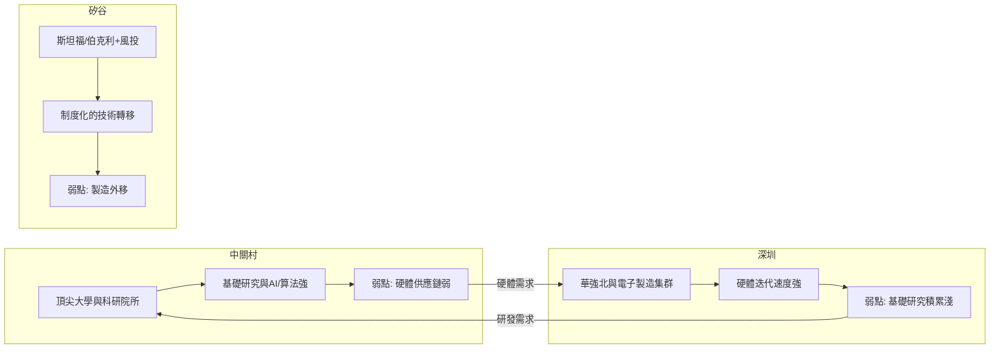

# 5.2 與深圳、矽谷的比較

把中關村放到全球座標系中，深圳與矽谷是最恰當的兩個參照。三地稟賦迥異：中關村的比較優勢是基礎研究與智力密度，深圳是製造供應鏈與市場化速度，矽谷是風險資本、大學—產業循環與全球人才虹吸。粗略地說，中關村強在 $H$（人才與研究）、深圳強在 $M$（製造與供應鏈響應速度）、矽谷強在 $V$（資本與制度化的創新循環）。三地的創新產出可抽象為

$$Y_{\text{中關村}} \sim H^{a}, \quad Y_{\text{深圳}} \sim M^{b}, \quad Y_{\text{矽谷}} \sim (H V)^{c}$$

矽谷之所以難以複製，正在於其人才與資本的耦合項。

**因果分析**：三地的分岔各有因果起點。深圳因毗鄰香港與特區政策，從「三來一補」起家，市場力量先於科研力量，故走硬體創業路線；中關村因計劃經濟時代的科教布局，科研力量先於市場力量，故走技術轉化路線。這一起點差異導致路徑依賴：深圳的華強北與中關村的電子一條街同為電子集市，但前者演進為全球硬體供應鏈節點，後者演進為資本與算法的聚集地。與矽谷相比，中關村的短板集中在三點：風險資本的長周期耐心、原創性基礎突破的產出率、以及對全球頂尖人才的開放度。因果上，這三點都與制度環境——產權保護、學術評價體系、國際流動性——相關，而非資金或人才總量的問題。理解這些結構性差異，比簡單的「中國矽谷」類比更有助於判斷中關村的未來。

## 參考要點
- 稟賦差異決定三地創新模式的分岔。
- 中關村與深圳實為互補而非同質競爭。
