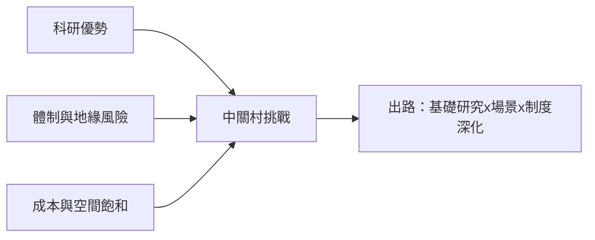

# 5.3 與深圳、矽谷的比較及未來挑戰

中關村、深圳與矽谷代表了三種創新生態的範式。中關村以「科研院所＋頂尖高校」為核心，強於基礎研究與人才供給；深圳以「硬體供應鏈＋製造速度」見長，華為、騰訊、大疆皆脱胎於產業配套而非學術外溢；矽谷則擁有斯坦福/伯克利、風投體系與全球最開放的資本與移民通道。三者的比較可用一個簡化函數表達：

$$
V \;=\; w_1 \cdot \text{科研} + w_2 \cdot \text{供應鏈} + w_3 \cdot \text{資本開放度}
$$

中關村在 $w_1$ 上佔優，深圳在 $w_2$ 上佔優，矽谷三項均衡且 $w_3$ 最高。

| 維度 | 中關村 | 深圳 | 矽谷 |
| --- | --- | --- | --- |
| 智力來源 | 清北＋中科院 | 移民工程師 | 斯坦福/伯克利＋全球移民 |
| 強項 | 基礎研究、AI | 硬體、製造 | 風投、原始創新 |
| 弱項 | 供應鏈距離、體制約束 | 基礎研究薄弱 | 成本高、政治極化 |

## 因果分析

回望全書的因果長鏈：太監墳場的低地價促成科教集聚，智力密度催生下海浪潮，下海浪潮倒逼試驗區制度，制度鬆綁放大PC與互聯網浪潮，每一波浪潮又為下一波積累人才與資本——中關村的傳記本質上是「知識存量」與「制度變數」交替驅動的動態系統。其未來挑戰亦由因果推得：一是地緣政治對晶片與跨境資本的約束（外生衝擊）；二是高校科研評價體制與企業需求之間的錯配（內生摩擦）；三是與深圳的分工——中關村輸出技術與算法，深圳輸出硬體與量產，兩者競合而非替代。能否把人才優勢轉化為制度性創新紅利，將決定這片昔日的太監墳場能否真正成為東方矽谷。

[返回目錄](README.md)
