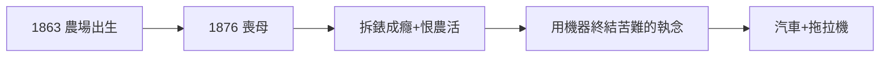

# 1.1 出生與母親之死（1863–1876）

1863 年 7 月 30 日，亨利·福特（Henry Ford）出生於密西根州迪爾伯恩附近的農場——內戰正酣之年。父親是愛爾蘭移民農場主，母親瑪麗溫柔虔誠，是全家唯一支持他擺弄機械的人。

## 1876：母親去世

13 歲喪母，是福特一生的轉折：「我此後再也沒有真正快樂過。」他把懷錶拆了裝、裝了拆，鄰居的鐘錶都經他手。父親希望他繼承農場，他痛恨農活——「農場的苦難必須用機器終結」，這個念頭後來變成拖拉機（福特森）與汽車。

## 機械少年的養成

- 12 歲得到第一塊懷錶，拆裝上癮；
- 15 歲離家到 Detroit 當機械學徒；
- 偶像：愛迪生（「那個留住聲音的人」）——多年後兩人成為摯友（見 5.2）。

**因果**：喪母的少年把情感寄託在齒輪上，「機器救人」的信念就此生根。下一節，他將進入愛迪生的公司——偶像的工廠。
