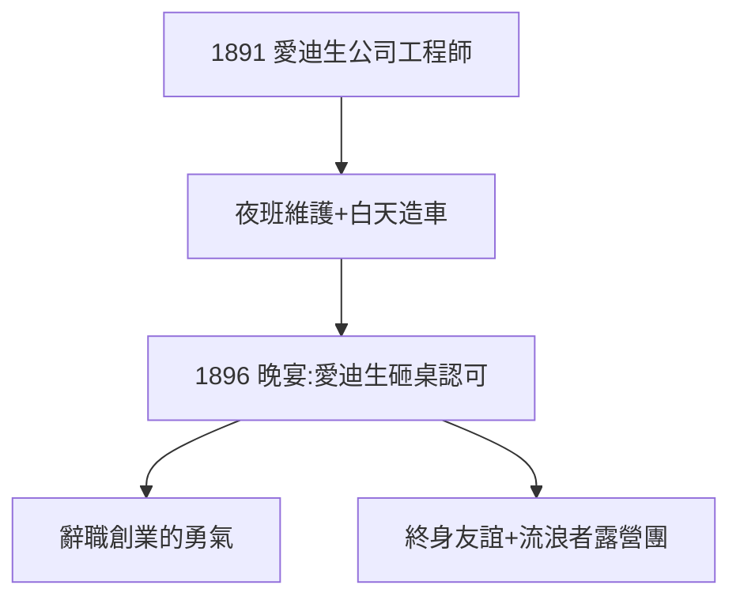

# 1.2 愛迪生照明公司（1891–1896）

## 底特律的工程師

1891 年，福特進入愛迪生照明公司底特律分廠當工程師，負責夜間發電機維護。夜班的好處：白天有時間在自家棚屋裡鼓搗汽油發動機。五年裡他升到總工程師，年薪可觀——但他心不在此。

## 1896：曼哈頓的晚宴

愛迪生照明公司年會上，28 歲的福特向 49 歲的愛迪生描述自己的四輪車構想。愛迪生用拳頭砸桌子：「年輕人，你搞對了！就是它！」——偶像的認可，讓福特辭職創業（見 2.1）。

## 師徒的起點

這次會面開啟了美國工業史上最著名的友誼：愛迪生、福特、哈維·凡士通、約翰·巴勒斯組成「流浪者」（Vagabonds）露營團，每年開車野營。1929 年福特把愛迪生故居整體搬到格林菲爾德村（見 5.2）。

**因果**：偶像的一句話，價值連城。愛迪生的認可既是精神燃料，也是信用背書——投資人聽說「愛迪生看好的人」，紛紛掏錢。下一節，四輪車問世。
