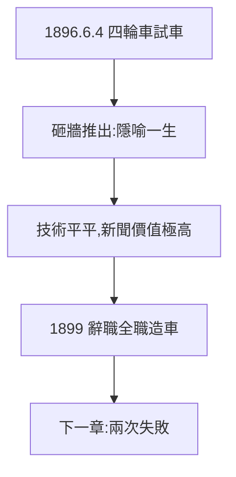

# 1.3 四輪車（1896）

## 1896 年 6 月 4 日凌晨

福特在棚屋裡造出第一輛「四輪車」（Quadricycle）：兩個汽缸、四馬力、車輪來自自行車。為了把它推出棚屋，他砸掉了磚牆——「牆可以再砌，機會不會再來。」試車成功，底特律的報紙登了豆腐塊消息。

## 四輪車的意義

- 技術上平平（同時期 Duryea 兄弟已造出更好的車）；
- 意義在人不在車：「愛迪生公司總工程師造出汽車」的新聞價值，勝過車本身；
- 砸牆的象徵：為新事物打破舊結構——他一生的隱喻。

## 辭職

1899 年辭去愛迪生公司職務，全職造車。偶像愛迪生的祝福（1.2）+ 四輪車的名氣 = 第一筆投資。

**因果**：四輪車是門票，不是終點。它最大的功能是讓福特相信「我能行」——而這種自信，將在接下來兩次公司倒閉中受到考驗。下一章，失敗。
