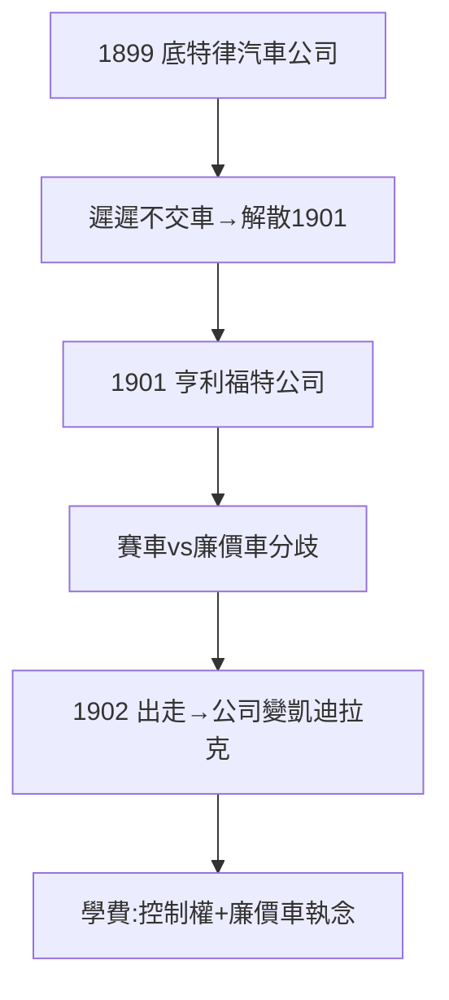

# 2.1 底特律汽車公司失敗（1899–1901）

## 第一次創業：慘敗

1899 年成立底特律汽車公司，投資人期望豪華車，福特卻埋頭改進發動機、遲遲不交車。1901 年公司解散——投資人認定他「只會做夢，不會交貨」。

## 第二次：亨利福特公司

1901 年再組亨利福特公司，合作者要求生產賽車賺快錢，福特想造廉價民用車，分歧不可調和。1902 年他憤然出走，公司改名凱迪拉克（Cadillac）——今天豪車品牌的 Geburt 竟是福特的棄子。

## 失敗的學費

- 教訓一：投資人的錢有代價——控制權之爭伴隨他一生（4.3 的獨裁源於此）；
- 教訓二：賽車是營銷，不是事業——但他學會了用賽車出名（見 2.2）；
- 三年兩敗，名聲掃地，卻磨出了「廉價車」的執念。

**因果**：四輪車的名氣（1.3）換來投資，投資帶來控制權之爭，兩次失敗教會他「絕對控股」。下一節，賽車 999 將為他贏回名聲——用對手想要的方式。
