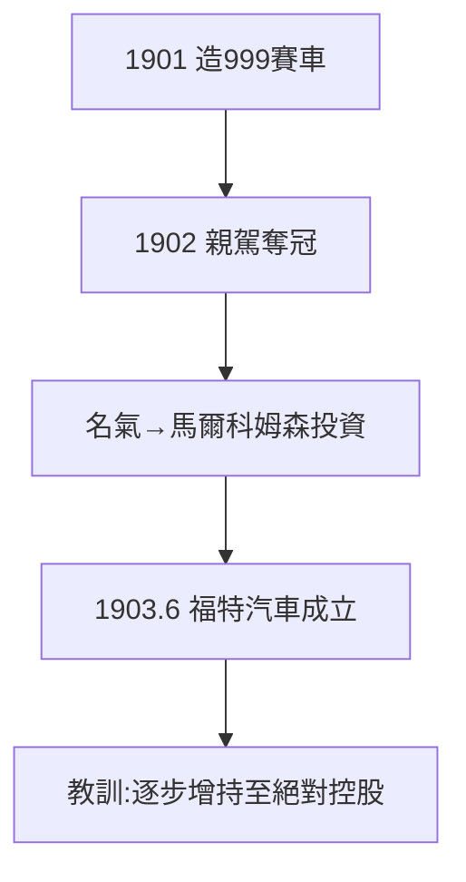

# 2.2 999 賽車（1901–1903）

## 以毒攻毒

既然投資人要賽車，福特就造一輛最快的：1901 年造出 999 賽車（以當年最快的火車命名），1902 年親自駕駛（他恐懼速度，卻硬著頭皮上）在格羅斯波因特賽道擊敗美國冠軍詹尼（Winton 車隊）——全場沸騰。

## 賽車的營銷學

- 勝利的新聞價值 > 技術價值；
- 煤炭大亨亞歷山大·馬爾科姆森（Malcomson）因此投資；
- 自行車賽手巴尼·奧德菲爾德駕駛 999 創紀錄，「福特」二字傳遍全美。

## 1903：捲土重來

靠著賽車名氣，1903 年 6 月 16 日，福特汽車公司（Ford Motor Company）成立，福特佔股 25.5%（後逐步增持至 100%）。這一次，他記住了 2.1 的教訓：**最終要絕對控股**。

**因果**：用投資人的邏輯（賽車）打敗投資人，贏得第三次機會。失敗（2.1）+ 名氣（本節）= 福特汽車。下一節，A 型車到 T 型車的鋪墊。
