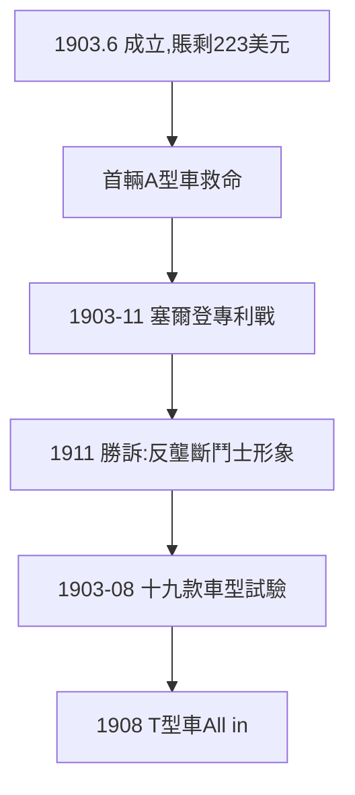

# 2.3 福特汽車成立（1903）

## 1903 年 6 月 16 日

福特汽車公司成立，資本 10 萬美元，福特任副總裁兼總工程師。7 月賣出第一輛 A 型車——公司賬上只剩 223 美元時，第一筆貨款到賬，死裡逃生。

## 塞爾登專利戰（1903–1911）

汽車製造商聯盟（ALAM）憑塞爾登專利向福特索要專利費，福特拒絕，對簿公堂八年。1911 年勝訴——法庭認定塞爾登專利只覆蓋特定發動機。**專利流氓**（以今日語言）敗給了實幹家，此案確立了福特「反壟斷鬥士」的公眾形象（諷刺的是，他日後自己成了壟斷者）。

## A 到 S 型車的試驗

1903–08 年推出 A、B、C、F、K、N、R、S 共 19 款車型，N 型車（1906）大賣——廉價、可靠。這些都是 T 型車的預演：**用多款車型做市場實驗，再 All in 一款**。

**因果**：賽車名氣（2.2）換來公司，專利戰贏得道義，十九款車贏得經驗。三者齊備，T 型車的時機到了。下一章，改變世界的十年。
