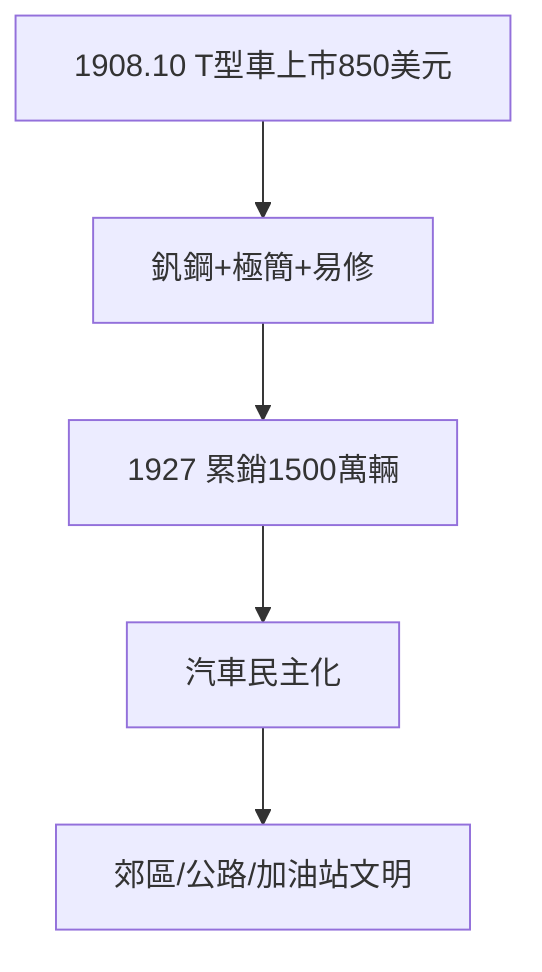

# 3.1 T 型車（1908）

## 1908 年 10 月 1 日

T 型車（Model T，暱稱「莉齊」Tin Lizzie）上市：售價 850 美元（後降到 260 美元），堅固、易修、能上爛路。到 1927 年停產，共售出 1500 萬輛——保持單一車型銷量紀錄近百年（直到大眾甲殼蟲超越）。

## 為什麼是 T 型車

- 釩鋼車身（輕而堅）；
- 設計極簡：只有黑色（「任何顏色，只要是黑色」——黑色乾得快）；
- 可維修性：農民用鐵絲就能修——呼應 1.1「機器救農民」的初心。

## 汽車民主化

T 型車之前，汽車是富人的玩具；之後，教師、農民、小店主都開得起。美國的郊區化、公路網、加油站文明，都從這輛車開始。

**因果**：十九款車的試驗（2.3）濃縮為一款神車。T 型車的成功帶來甜蜜的煩惱——需求太大，手工裝配跟不上。下一節，流水線登場。
