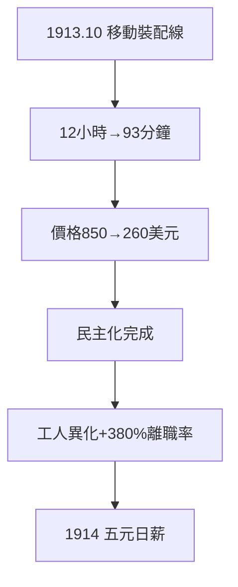

# 3.2 流水線（1913）

## 1913 年 10 月 7 日：高地公園

福特在高地公園工廠啟用**移動裝配線**：底盤放在傳送帶上，工人站定只做一道工序。T 型車裝配時間從 12 小時降到 93 分鐘，效率提升 8 倍。價格從 850 美元一路降到 260 美元。

## 誰發明了流水線

- 屠宰場的「分解線」（辛克萊《屠場》描寫過）給了靈感；
- 團隊功臣：索倫森、弗蘭德、克拉倫斯·艾弗里；
- 福特的貢獻：決心 + 執行——把別人的點子變成世界。

## 流水線的雙面

- 正面：汽車民主化的物質基礎（3.1 的降價全靠它）；
- 反面：工人變成機器的附件，離職率高達 380%——逼出下一節的五元日薪。

**因果**：T 型車的需求（3.1）逼出流水線，流水線逼出勞工危機。技術解決一個問題，製造下一個問題——福特用錢解決（下一節），而不是用人性解決。這預示了他與勞工的終身戰爭。
