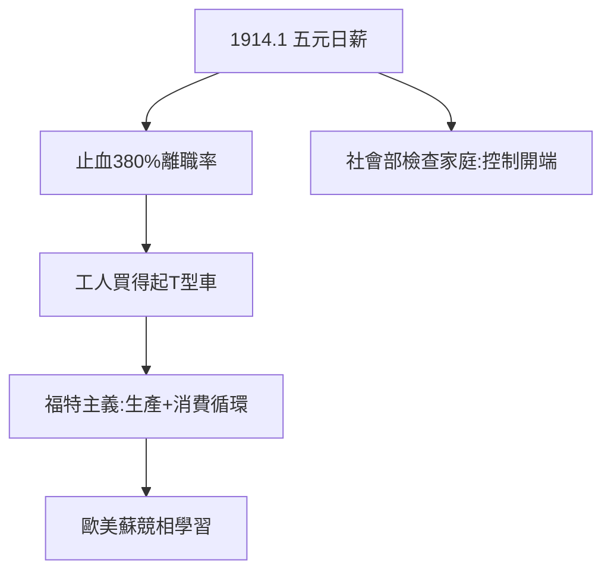

# 3.3 五元日薪（1914）

## 1914 年 1 月 5 日

福特宣布：日薪 5 美元（當時行業平均 2.34 美元），工時從 9 小時降到 8 小時。一萬人冒著嚴寒在工廠門口排隊應聘，場面失控需警察維持。全美譁然：華爾街罵他「給工人太多」，工人奉他為聖人。

## 五元的算計

- 表面：慈善；
- 實際：380% 離職率的止血藥 + 培養「買得起 T 型車」的消費者（最早的「需求側管理」）；
- 附帶：社會部（Sociological Department）上門檢查工人家庭——喝酒、賭博者取消資格，家長式控制的開端。

## 福特主義

高工資 + 大規模生產 + 大眾消費 = **福特主義**（Fordism）。凱因斯主義之前，資本主義自我拯救的第一個方案。歐洲（尤其是蘇聯，第一個五年計劃全套引進福特制）競相學習。

**因果**：流水線的危機（3.2）用錢擺平，順手發明了 20 世紀的生產-消費模式。但「社會部」暴露了他的另一面：給錢，也要管靈魂。下一章，帝國的陰影。
