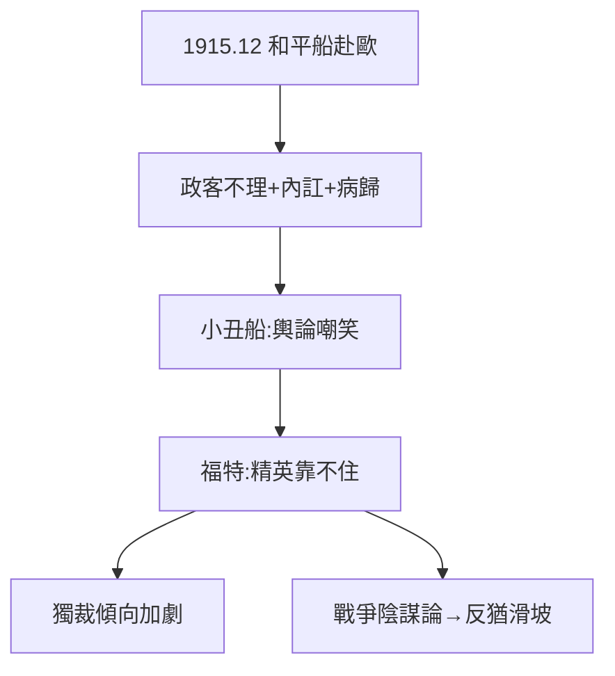

# 4.1 和平船（1915）

## 1915 年 12 月：奧斯卡二號

一戰爆發，福特包下「奧斯卡二號」郵輪，載著和平主義者駛往歐洲，宣稱「要在聖誕節前把小伙子們從戰壕裡帶出來」。記者隨行，全球矚目——結果：歐洲政客無人理會，代表團內訌，福特中途生病回國。和平船空手而歸。

## 天真的代價

- 被嘲笑為「小丑船」，愛迪生私下都搖頭；
- 但福特不在乎：他真心相信戰爭是「銀行家和軍火商的陰謀」（這個信念後來滑向反猶，見 4.2）；
- 和平船的失敗讓他認定：**精英靠不住，只能靠自己**——獨裁傾向加劇。

## 孤立主義的先聲

和平船是美國孤立主義的民間預演：1919 年參議院否決國聯，美國退回孤立。福特的失敗，恰恰說出了多數美國人的心聲。

**因果**：五元日薪的聖人（3.3）想當世界聖人，摔得很慘。和平船的失敗沒有讓他謙卑，反而讓他更相信自己——並把「幕後黑手」的懷疑指向猶太人。下一節，最黑暗的一章。
