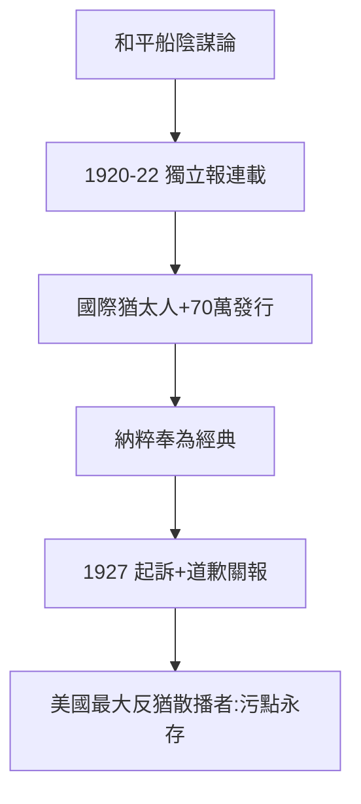

# 4.2 反猶與迪爾伯恩獨立報（1920–1927）

## 《國際猶太人》

1920–22 年，福特收購的《迪爾伯恩獨立報》連載反猶文章，集結為《國際猶太人》（The International Jew），聲稱猶太人操縱戰爭、金融與媒體。發行量一度達 70 萬份，納粹德國奉為經典——希特勒在《我的奮鬥》中點名讚揚福特，辦公室掛著他的肖像；1923 年啤酒館暴動審判時，希特勒說自己的資金部分來自福特（未證實）。

## 1927：被迫道歉

猶太團體起訴，福特1927 年發表道歉聲明、關閉報紙。但傷害已成：他是美國歷史上散播反猶主義能量最大的人，沒有之一。

## 根源

- 和平船的「幕後黑手」論（4.1）；
- 助手利博德（Liebold）的慫恿與偽造文件（《錫安長老會紀要》）；
- 農場少年的世界觀：簡單、陰謀化、非黑即白（1.1 的另一面）。

**因果**：機器救人的聖人（第 3 章）與散播仇恨的罪人是同一個人。福特的悲劇在於：他的世界觀停留在農場（1.1），而他的影響力覆蓋了世界。下一節，帝國的內部：控制狂。
