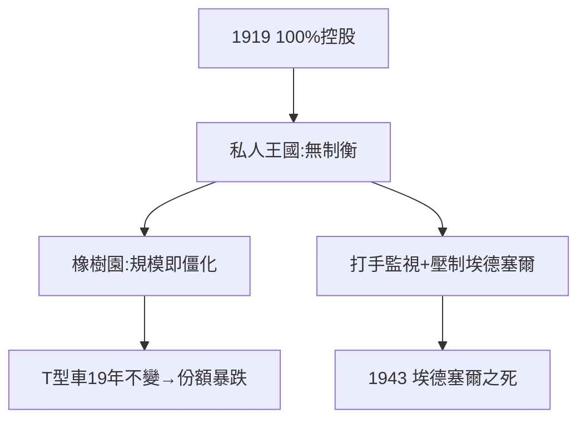

# 4.3 橡樹園與控制狂（1919–1929）

## 1919：買斷股份

福特以 1.05 億美元買下所有小股東（包括道奇兄弟），實現 100% 控股——2.1 的教訓（控制權）的終極兌現。從此福特汽車是他的私人王國：無董事會制衡，無財務公開，兒子埃德塞爾（Edsel）名為總裁、實為傀儡。

## 橡樹園（River Rouge）

1917–28 年建成全球最大的一體化工廠：鐵礦石進來，汽車出去，40 萬工人。規模即權力——但也意味著僵化：當通用汽車用「多品牌+年度改款」競爭時，福特堅持 T 型車十九年不變（1908–27），市場份額從 50% 跌到 30%。

## 控制狂的代價

- 社會部升級為「服務部」（Service Department），頭子哈里·貝內特（Bennett）豢養打手，監視、毆打工會分子；
- 埃德塞爾的天才設計（A 型車 1927 的功臣）被父親百般壓制，1943 年抑鬱而死——福特帝國最痛的人倫悲劇。

**因果**：2.1 的學費（要控股）異化為絕對獨裁。絕對權力帶來絕對僵化——市場懲罰了他，家庭也懲罰了他。下一章，大蕭條：帝國的黃昏。
