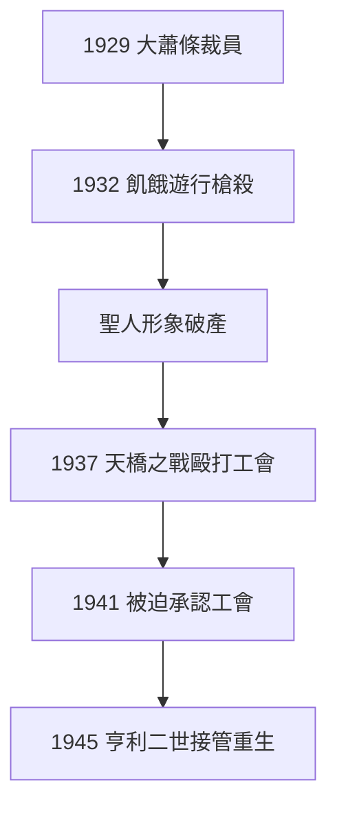

# 5.1 大蕭條與勞工鎮壓（1929–1941）

## 1932：飢餓遊行

大蕭條中福特大幅裁員，1932 年失業工人遊行到橡樹園，被公司警衛與警察開槍鎮壓，4 死數十傷（福特飢餓遊行慘案）。「五元日薪的聖人」（3.3）下令向工人開槍——形象徹底破產。

## 1937：天橋之戰

工會（UAW）組織福特工人，貝內特的打手在天橋上圍毆工會領袖（Battle of the Overpass），照片登上全國報紙。福特是底特律三大中最後一個承認工會的（1941 年，被迫）。

##  stubborn 的代價

- 市場：通用、克萊斯勒超越，福特跌至第三；
- 家庭：埃德塞爾 1943 年去世，福特中風，孫子亨利二世 1945 年接管，大清洗貝內特黨羽；
- 帝國在他手中衰敗，在孫子手中重生。

**因果**：控制狂（4.3）+ 蕭條 = 暴力。福特用對待機器的邏輯對待人，終於遭到反噬。下一節，晚年的溫情：愛迪生與格林菲爾德村。
