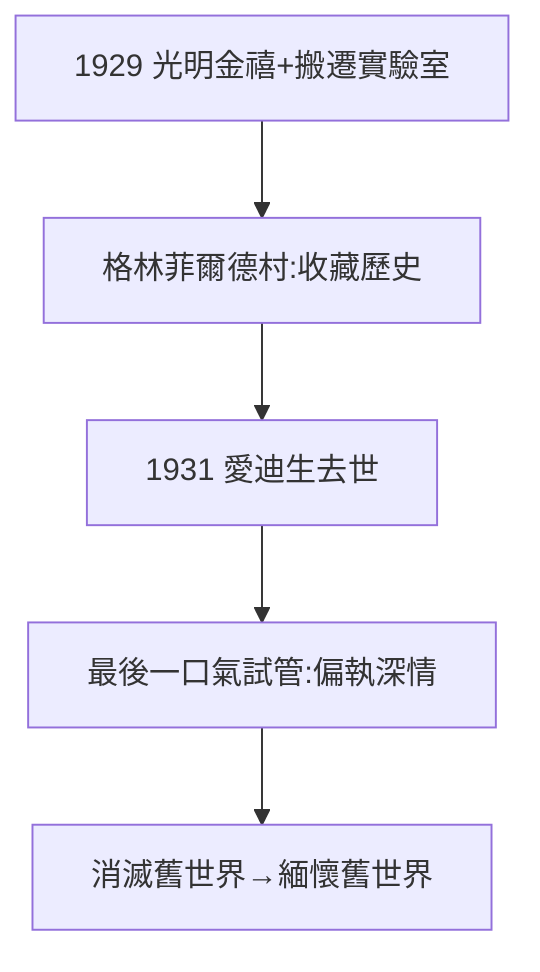

# 5.2 愛迪生的友誼與格林菲爾德村（1929–1940）

## 1929：光明金禧

福特為愛迪生舉辦電燈發明 50 週年慶（Light's Golden Jubilee），把門洛帕克實驗室整體搬到格林菲爾德村（Greenfield Village）——他收藏美國歷史：農具、火車、愛迪生的故居。1931 年愛迪生去世，福特據說收集了「愛迪生最後一口氣」（密封試管，今藏博物館）——偏執的深情。

## 格林菲爾德村的意義

- 表層：懷舊，收藏前工業時代；
- 深層：對自己親手摧毀的世界的鄉愁——汽車殺死了馬車、鄉村、小鎮，而他把標本供在博物館裡；
- 農場少年（1.1）的輪迴：用一生消滅農場，再用餘生緬懷農場。

## 流浪者不再

愛迪生死後，露營團解散。福特晚年孤獨：兒子反目（4.3）、朋友凋零、帝國旁落。格林菲爾德村是他的時間膠囊，也是避難所。

**因果**：1.2 的友誼（1896 晚宴）橫跨 35 年，以博物館告終。福特的懷舊是真誠的，也是諷刺的：他紀念的，正是他埋葬的。下一節，蓋棺。
