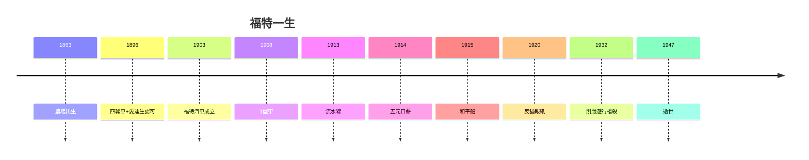

# 5.3 1947 逝世與評價（1947）

1947 年 4 月 7 日，福特在迪爾伯恩去世，享年 83 歲。送葬隊伍綿延數里，工人自發悼念——恨他的人（工會）與愛他的人（老工人）都來了。

## 蓋棺：四個福特

| 身份 | 功 | 過 |
|---|---|---|
| 發明家企業家 | T 型車、流水線、汽車民主化 | 僵化，T 型車十九年不變 |
| 勞工聖人 | 五元日薪、福特主義 | 飢餓遊行、天橋之戰 |
| 和平主義者 | 和平船的真誠 | 反猶報紙，納粹的精神彈藥 |
| 慈善家 | 格林菲爾德村、醫院 | 控制狂，逼死兒子 |

## 歷史的判決

福特證明了：**一個人可以同時是天才與惡棍、聖人與罪人**。他的流水線養活了世界，他的報紙毒害了世界。評價他，必須同時舉起兩隻手——一隻讚美，一隻譴責。

**因果閉環**：恨農活的少年（1.1）用機器終結了農耕時代，懷舊的老人（5.2）把農耕時代供進博物館。從砸牆推出四輪車（1.3）到躺進迪爾伯恩的墳墓——牆拆了又砌，砌了又拆，這就是福特：**永遠在打破，也永遠在懷念被打破的**。
