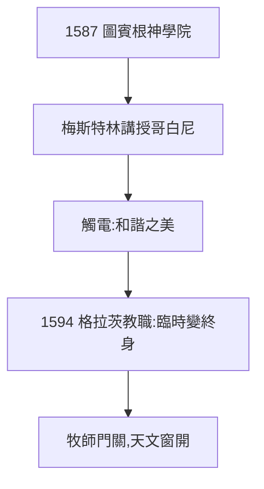

# 1.2 神學院與梅斯特林（1587–1591）

## 圖賓根神學院

1587 年入圖賓根大學，原定當路德宗牧師。在這裡遇到改變命運的老師：梅斯特林（Mästlin），公開講授哥白尼日心說（當時多數大學仍只教托勒密）。克卜勒如觸電：「我第一個理解了哥白尼的和諧。」

## 為什麼是他接受日心說

- 新教背景：路德本人反哥白尼，但新教鼓勵讀原典（圣经/自然之书）；
- 數學品味：他相信上帝用幾何創造世界，日心說更「美」——美即真理的預設，伴隨他一生（2.1 的多面體宇宙）；
- 1588 年學士，1591 年碩士，成績第二名——本可順利當牧師。

## 命運的岔路

1594 年，格拉茨新教學校缺數學教師，圖賓根推薦了他——本是臨時差事，卻成了終身職業。**上帝關上牧師的門（後因教義被逐出教會，見 4.2），打開天文的窗**。

**因果**：神學院的本意是培養牧師，結果培養了日心說的立法者。梅斯特林的一句講授，勝過十年寒窗——下一節，格拉茨。
