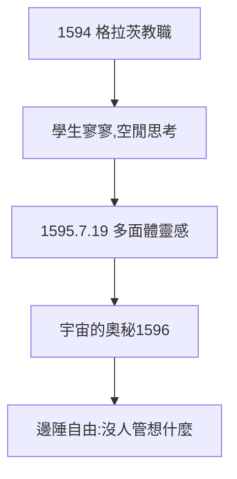

# 1.3 格拉茨教師（1594）

## 1594：邊陲小城的數學教師

格拉茨（奧地利南部）新教學校的數學教師職位無人問津，23 歲的克卜勒上任。學生不多（第一年沒幾個，第二年零個——校長勸他別灰心），但他利用空閒思考宇宙結構。

## 1595 年 7 月 19 日：靈感

課堂上畫三角形與圓時，他突然想到：行星軌道半徑之比，是否對應正多面體嵌套？六顆行星、五種正多面體——數字吻合得天衣無縫（2.1 詳述）。他後來寫道：「我覺得自己看到了上帝的藍圖。」

## 邊陲的優勢

格拉茨遠離學術中心，反而自由：沒人管他想什麼。1597 年反新教浪潮中他被驅逐（後因豁免返回），顛沛反而堅定了「數學即信仰」。

**因果**：神學院的日心說（1.2）+ 邊陲的自由 = 多面體宇宙。被發配邊疆，反而撿到宇宙——下一章，《宇宙的奧秘》。
