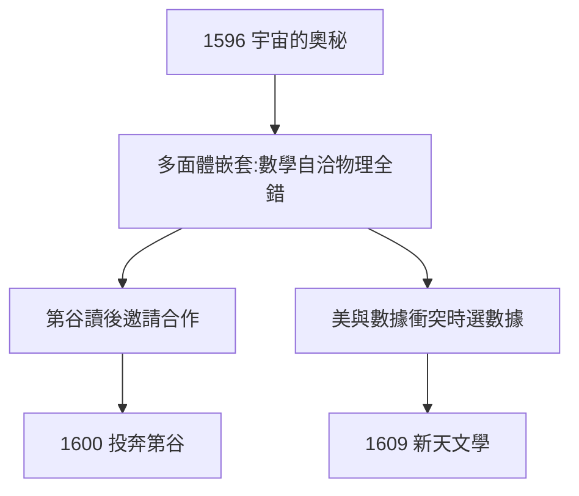

# 2.1 宇宙的奧秘（1596）

## 《宇宙的奧秘》（Mysterium Cosmographicum）

1596 年出版：六顆行星軌道由五種正多面體嵌套決定——土星（正方體）→木星（正四面體）→火星（正十二面體）→地球（正二十面體）→金星（正八面體）→水星。數學上自洽，物理上全錯（還有第七顆行星呢？）。

## 錯誤的偉大

- 第谷讀後邀請他合作（見 2.3）——錯誤的書帶來正確的機會；
- 伽利略讀後不屑（兩人通信，伽利略從不公開支持他）；
- 錯誤的多面體模型，逼他尋找真正的定律——沒有 1596 的錯，就沒有 1609 的對（3.3）。

## 「美即真理」的代價

1.2 的審美預設（上帝用幾何創造）在此登峰，也在此碰壁。克卜勒的可貴在於：**當數據（第谷的）與美衝突時，他選擇數據**——八弧分（3.2）殺死了多面體。

**因果**：格拉茨的靈感（1.3）寫成書，錯誤的書敲開第谷的門。科學史上「錯誤的偉大」莫過於此——下一節，先結婚。
