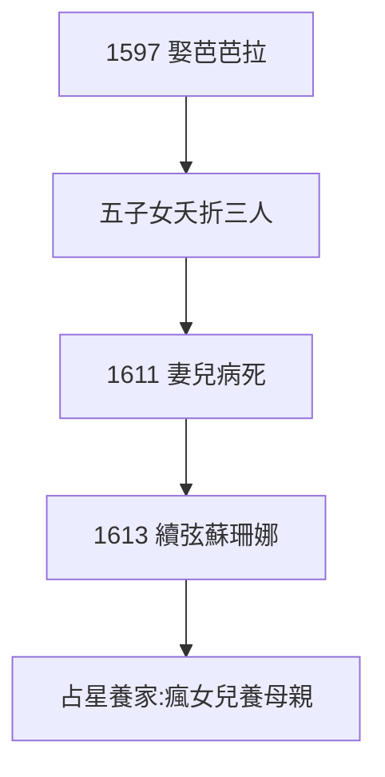

# 2.2 婚姻（1597）

## 1597 年 4 月：迎娶芭芭拉

經人介紹，娶寡婦芭芭拉·米勒（Barbara Müller），陪嫁豐厚（磨坊主之女）。婚後育有五子女，夭折三人——17 世紀的常態，克卜勒的噩夢。

## 婚姻的底色：不幸

- 芭芭拉不懂他的宇宙，婆媳矛盾，經濟拮据；
- 1611 年，芭芭拉與愛子相繼病死，克卜勒在給友人的信中寫：「我的家庭毀了」；
- 續弦蘇珊娜（1613），生七子女，總算安穩——但原配的陰影終身不散。

## 占星養家

為養家，克卜勒大量編制星曆、算命（華倫斯坦是客戶，見 5.1）。他鄙視占星（「占星是天文學的瘋女兒，但母親靠女兒養活」），卻靠它吃飯——理想與麵包的永恆矛盾。

**因果**：《奧秘》的作者（2.1）養不起家，靠「瘋女兒」吃飯。這種撕裂伴隨一生：白天算命，晚上算軌道——而算軌道的數據，來自第谷（下一節）。
