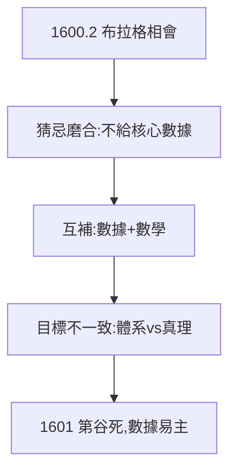

# 2.3 投奔第谷（1600）

## 1600 年 2 月：布拉格相會

格拉茨驅逐新教徒，克卜勒失業。第谷（時為魯道夫二世宮廷數學家）邀請他到布拉格附近的貝納特基城堡合作。初見並不愉快：第谷把他當助手，不給核心數據；克卜勒想要火星數據，第谷只給外圍課題——兩個天才的磨合充滿猜忌。

## 合作的互補

- 第谷：二十年 naked-eye 觀測，精度 1 弧分，宇宙第一數據庫；
- 克卜勒：數學天才，日心說信徒，渴望數據；
- 第谷要的是「第谷體系」的證明者，克卜勒要的是真理——目標從第一天就不一致。

## 1601 年 10 月：轉折

第谷猝死（見 3.1），克卜勒繼任宮廷數學家，**繼承全部觀測數據**——歷史上最富傳奇色彩的「學術繼承」。第谷生前最擔心的事（數據被用來證明哥白尼）恰恰發生了。

**因果**：《奧秘》的錯誤（2.1）換來邀請，失業換來相會，猜忌換來繼承——每一步都是因禍得福。下一章，第谷之死與火星之戰。
