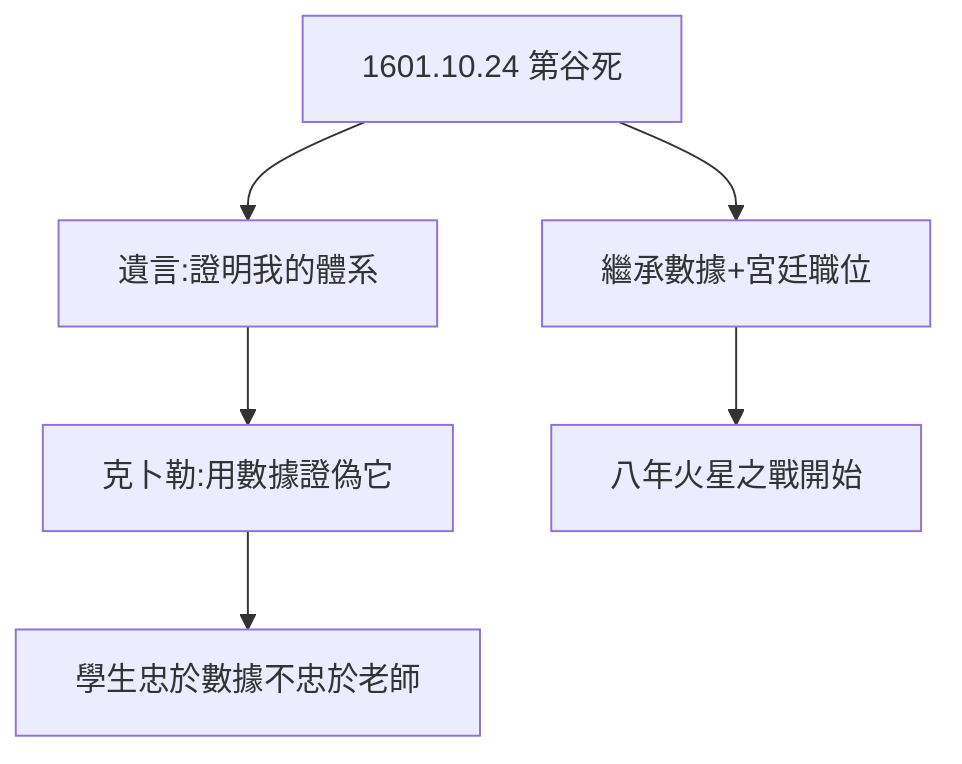

# 3.1 第谷之死（1601）

## 1601 年 10 月 24 日

第谷在貴族宴會上憋尿過久（宮廷禮儀不許中途離席），膀胱破裂，十一日後死於尿毒症，享年 54 歲。臨終拉著克卜勒的手說：「別讓我白活，要證明我的體系。」——克卜勒口頭答應，轉身就用數據證明了哥白尼。

## 死因之謎

- 傳統說法：憋尿（克卜勒記載）；
- 2010 年開棺驗證：汞含量不高，排除謀殺（開普勒下毒說破產），死於尿毒症/前列腺；
- 遺言的諷刺：被繼承者背叛，正是科學進步的方式——**學生不必忠於老師，只需忠於數據**。

## 繼承

克卜勒接任宮廷數學家，年薪並不兌現（宮廷欠薪是常態，見 5.2），但數據到手。1601 年的冬天，他擁有了人類歷史上最精確的天文數據，和一顆要為之奮鬥八年的火星。

**因果**：猜忌的合作（2.3）以死亡終結，以繼承延續。第谷攢了二十年數據，克卜勒用了八年——下一節，八弧分。
