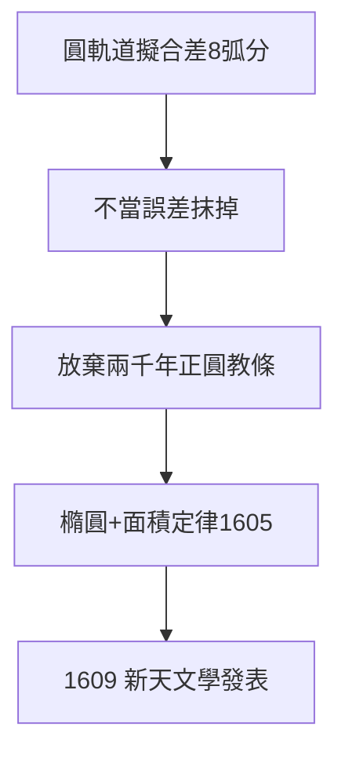

# 3.2 八弧分（1601–1605）

## 八弧分的戰爭

克卜勒用圓軌道 + 均輪擬合第谷的火星數據，最佳結果仍有 **8 弧分**的偏差（滿月的 1/4 寬度）。別人會當作誤差抹掉（第谷的精度約 1–2 弧分，8 弧分不可容忍），克卜勒卻說：「這 8 弧分為天文學的改革指明了道路。」

## 放棄正圓

- 兩千年的正圓教條（柏拉圖→托勒密→哥白尼都沒放棄）；
- 克卜勒試遍卵形、蛋形，最後接受**橢圓**：太陽在焦點上；
- 同時得到面積定律（相等時間掃過相等面積）——第一、二定律誕生（1605 年基本完成，1609 年發表）。

## 八弧分的哲學

科學史上「不放過小偏差」的典範（參照瑞利的氬、貝爾的脈衝星）：**真理藏在誤差裡**。8 弧分殺死了正圓，也殺死了多面體宇宙（2.1）。

**因果**：第谷的數據（3.1）+ 不放過偏差的執念 = 橢圓。多面體的「美」（2.1）死於 8 弧分的「真」。下一節，《新天文學》。
