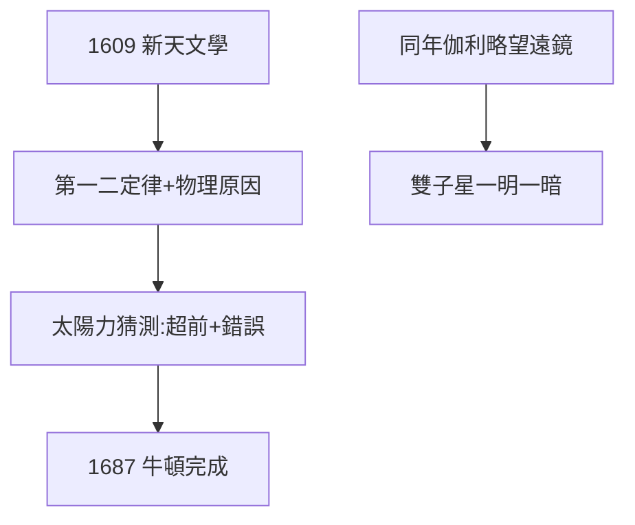

# 3.3 新天文學（1609）

## 《新天文學》（Astronomia Nova）

1609 年出版，副標題霸氣：「基於原因的、或天體物理學」——第一次有人宣稱天文學要有**物理原因**（太陽的磁力驅動行星），而不只是幾何描述。第一定律（橢圓）、第二定律（面積）正式發表。

## 物理直覺的超前與錯誤

- 超前：太陽力隨距離減弱（ $F \propto 1/r$ 的猜測，接近萬有引力）；
- 錯誤：認為是磁力掃掠（像齒輪帶動），行星需要不斷推動（亞里士多德慣性觀未除）；
- 牛頓 1687 年糾正並完成（見 5.3）——克卜勒搭台，牛頓唱戲。

## 1609：奇蹟年

同年伽利略用望遠鏡看到木星衛星、月面山脈。兩人互贈新書，伽利略卻從不公開支持克卜勒（怕惹麻煩）——天文革命的雙子星，一明一暗。

**因果**：八弧分（3.2）結晶為定律，定律等待物理靈魂（牛頓）。1609 年之後，克卜勒進入人生多事之秋：母親涉巫、戰爭、欠薪——下一章。
