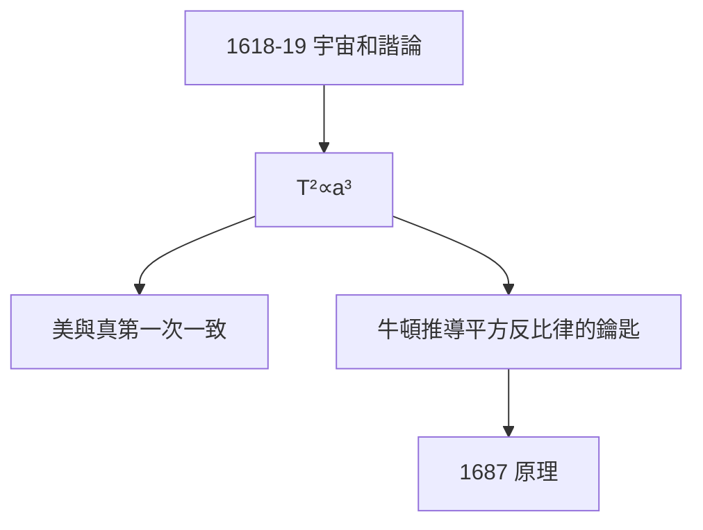

# 4.1 第三定律（1618–1619）

## 1618 年 3 月 8 日（及 5 月 15 日）

克卜勒在《宇宙和諧論》（Harmonices Mundi，1619）中宣布第三定律：行星週期的平方與軌道半長軸的立方成正比，

$$T^2 \propto a^3$$

他先算錯一次（3 月 8 日），兩個月後修正——誠實記錄在書中。這種「把錯誤也寫進書」的坦率，前無古人。

## 和諧的執念

第三定律源於他畢生的「和諧」迷戀（1.2 的美、2.1 的多面體）：行星速度對應音階，土星是低音，水星是高音——宇宙是一首歌。這一次，美與真終於一致。

## 牛頓的鑰匙

第三定律是牛頓推導萬有引力的關鍵（$F \propto 1/r^2$ 的數學來源）。沒有 $T^2 \propto a^3$，就沒有《原理》——克卜勒無意中為牛頓鋪好了最後一塊磚。

**因果**：從多面體的錯美（2.1）到橢圓的真（3.3）再到和諧的真美（本節）——二十三年一個輪迴。而在他發現和諧的同時，母親正被當作女巫審判（下一節）。
