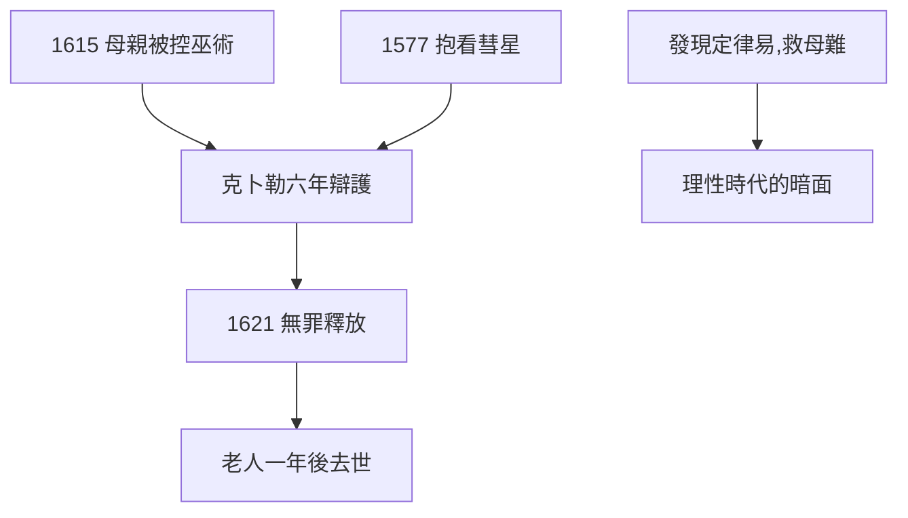

# 4.2 母親巫術案（1615–1621）

## 1615：母親被控巫術

克卜勒的母親卡塔琳娜（文盲、草藥醫）被鄰居指控巫術，1615–21 年審判，險些被 torture。克卜勒動用一切人脈：寫辯護狀（長達數百頁的法律文書，展示了他驚人的法學才能）、親自出庭，最終 1621 年無罪釋放——但老人家一年後去世，驚嚇所致。

## 科學家的無力

- 發現三大定律的人，救母親用了六年；
- 辯護狀的邏輯無懈可擊（指出證詞矛盾、程序違法），卻差點沒用——因為對手不講邏輯；
- 17 世紀德國獵巫（約四萬人被處死）是理性時代的暗面：克卜勒用法治對抗迷信，贏得艱難。

## 母子

母親是抱他看彗星的人（1.1），是他天文啟蒙的起點。他救母親，如同回報 1577 年的那個夜晚。

**因果**：第三定律（4.1）的榮光與母親的牢獄同步——天上和諧，人間獵巫。克卜勒用法律救出母親，卻救不了時代。下一節，星表。
