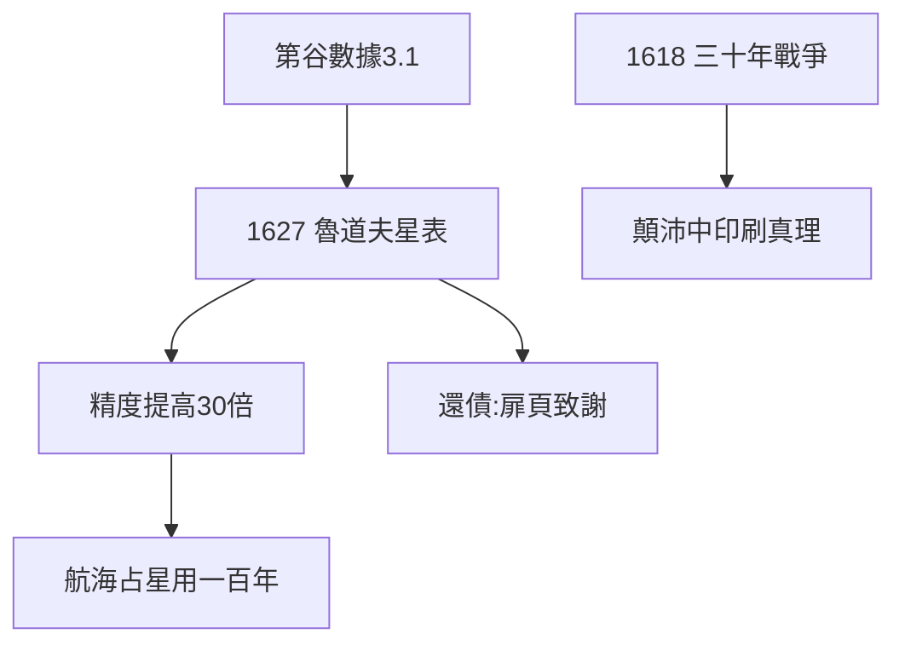

# 4.3 星表（1627）

## 《魯道夫星表》（Tabulae Rudolphinae）

1627 年出版，以贊助人魯道夫二世命名。基於第谷數據 + 橢圓定律，精度比前代提高 30 倍以上：預報行星位置誤差從 5° 降到 10′ 以內。航海家、占星家用了它一百年。

## 還債：對第谷的承諾

- 星表扉頁放第谷像，還大篇幅致謝——儘管他證偽了第谷體系（3.1 的背叛），面子給足；
- 欠薪問題：宮廷欠他多年薪水，星表出版費都是東拼西湊；
- 科學史上「繼承者義務」的典範：用了數據，就要交貨。

## 三十年戰爭的陰影

1618 年戰爭爆發，新教的克卜勒在天主教陣營顛沛流離。星表出版同年，他被迫離開林茨——**真理的書，在戰火中印刷**。

**因果**：第谷的數據（3.1）+ 橢圓定律（3.3）= 星表。二十六年的承諾兌現——而兌現之時，贊助人已死、戰火正熾、薪水無著。下一章，最後的三年。
