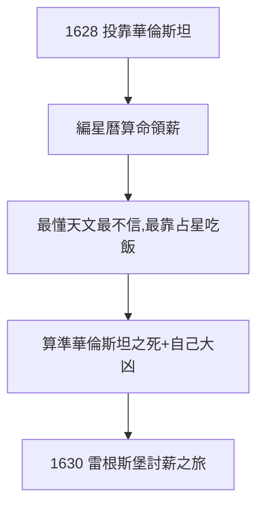

# 5.1 華倫斯坦的占星師（1628–1630）

## 投靠華倫斯坦

1628 年，克卜勒投靠三十年戰爭中的僱傭軍統帥華倫斯坦（Wallenstein），職責：編星曆、算命、兼管印刷。華倫斯坦迷信占星，克卜勒鄙視占星（2.2 的「瘋女兒」論）——卻靠它領薪水。理想主義者向現實低頭的標本。

## 預言的諷刺

- 他為華倫斯坦算出「大難臨頭」（1634 年果被暗殺）——算準了，沒救了人；
- 他給自己的星盤顯示 1630 年大凶——也算準了（見 5.2）；
- 占星史上最懂天文的人，最不信占星——卻最靠占星吃飯。

## 欠薪的追討

宮廷欠薪累計數千弗羅林，華倫斯坦答應代付。1630 年秋，克卜勒親自去雷根斯堡討薪——這趟旅程要了他的命。

**因果**：婚姻的貧困（2.2）→ 占星養家 → 投靠軍閥。從格拉茨的教師（1.3）到軍閥的幕僚，三十六年一個輪迴：起點為麵包教書，終點為欠薪送命。下一節，最後一程。
