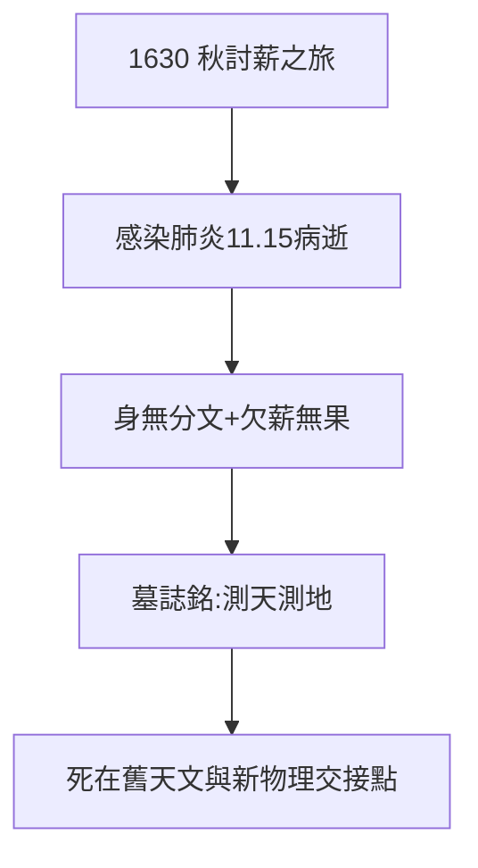

# 5.2 索薪之旅與病逝（1630）

## 1630 年 11 月 15 日：雷根斯堡

克卜勒騎馬冒寒前往雷根斯堡討薪，途中感染肺炎（一說癤瘡併發），11 月 15 日病逝，年僅 58 歲。死時身無分文，宮廷欠薪分文未討到。墓地後毀於戰火，墓誌銘是他自撰：

> 我曾測天，今測地；天庭的光榮，塵世的陰影。
> （Mensus eram coelos, nunc terrae metior umbras...）

## 欠薪的荒誕

- 發現三大定律的人，死於討薪路上；
- 宮廷欠他的錢，後人追討多年無果；
- 科學與權力的關係：用得著時是國師，用不著時是債主——第谷（《第谷傳》3.3）也一樣。

## 1630：時代的節點

同年，三十年戰爭正酣，伽利略準備出版《對話》（1632）。舊天文（第谷-克卜勒）落幕，新物理（伽利略-牛頓）開場——克卜勒死在交接點上。

**因果**：占星養家（2.2）→ 投靠軍閥（5.1）→ 討薪送命。一生為錢所困，死後名垂千古——錢與名的永恆錯位。下一節，牛頓的肩膀。
