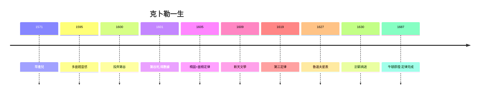

# 5.3 牛頓的肩膀（1630–1687）

## 「站在巨人肩膀上」

牛頓 1676 年信中名言（原話出自 12 世紀沙特爾的伯納德，但經牛頓傳播）：「如果我看得更遠，那是因為站在巨人的肩膀上。」——巨人之一，就是克卜勒。牛頓用第三定律推出平方反比律（4.1），用第一定律確定軌道形狀。

## 三定律的命運

| 定律 | 發現 | 完成者 |
|---|---|---|
| 橢圓（第一） | 克卜勒 1605/09 | 牛頓證明：平方反比→圓錐曲線 |
| 面積（第二） | 克卜勒 1605/09 | 牛頓：角動量守恆 |
| 和諧（第三） | 克卜勒 1618/19 | 牛頓：萬有引力定律 |

## 早產兒的勝利

1571 年的早產兒（1.1），體弱、貧困、喪妻、喪子、討薪而死——卻立法天空。克卜勒證明：**立法者不需要王位，只需要數據和誠實**（八弧分，3.2）。

**因果閉環**：彗星的震撼（1.1）→ 多面體的錯（2.1）→ 八弧分的真（3.2）→ 三定律（3.3、4.1）→ 牛頓的完成。早產兒用 58 年走完從觀星到立法的全程——而立法的報酬，是討薪路上的肺炎。這就是「天空立法者」的全部：**天上給他定律，人間不給他薪水**。
