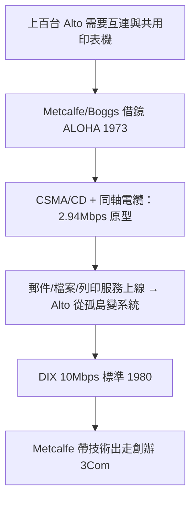

# 3.1 乙太網路：連結 Alto 的血管（1973-1980）

當 PARC 裡擺滿上百台 Alto，接著的問題立刻浮現：機器之間如何傳檔案、如何共用印表機？Robert Metcalfe 與 David Boggs 在 1973 年的備忘錄中提出解方——**乙太網路（Ethernet）**。靈感來自夏威夷大學的 ALOHA 無線網路，但 Metcalfe 把它改造成有線同軸電纜上的分散式協定：每台機器想送就送，碰撞了就退避重送（CSMA/CD），以隨機退避化解衝突，數學上可證明在負載 $G$ 下吞吐量 $S = G e^{-2G}$ 仍具實用效率。

第一版乙太網路跑 2.94 Mbps，足以在幾秒內傳送整頁位元映射影像；1976 年 Metcalfe 與 Boggs 發表經典論文，1980 年再與 DEC、Intel 聯手推出 10 Mbps 的 DIX 標準。乙太網路的真正意義不在速度，而在**哲學**：它把 Alto 從孤島變成系統——電子郵件、檔案伺服器、共用列印都依賴它。沒有網路，Alto 只是昂貴的打字機；有了網路，它成了「分散式辦公室」的原型。

Metcalfe 後來提出著名的梅特卡夫定律——網路價值 $\propto n^2$ 。這條定律的第一個實驗場就是 PARC 大樓：Alto 越多、網路越有用；網路越有用、Alto 越不可或缺。兩者形成正回饋。而這個回饋，正是 Metcalfe 1979 年離開 PARC 創辦 3Com、把乙太網路商品化的信心來源（見 4.2 節）。

### 因果鏈
Alto 普及製造連網需求 → ALOHA 提供隨機存取思想 → 乙太網路以簡單粗暴的碰撞重送贏得實用性 → 網路服務反哺 Alto 價值（ $n^2$ 效應）→ 標準化成功卻由 3Com 在外部收割。PARC 發明了血管，卻把輸血的生意讓給了別人。
