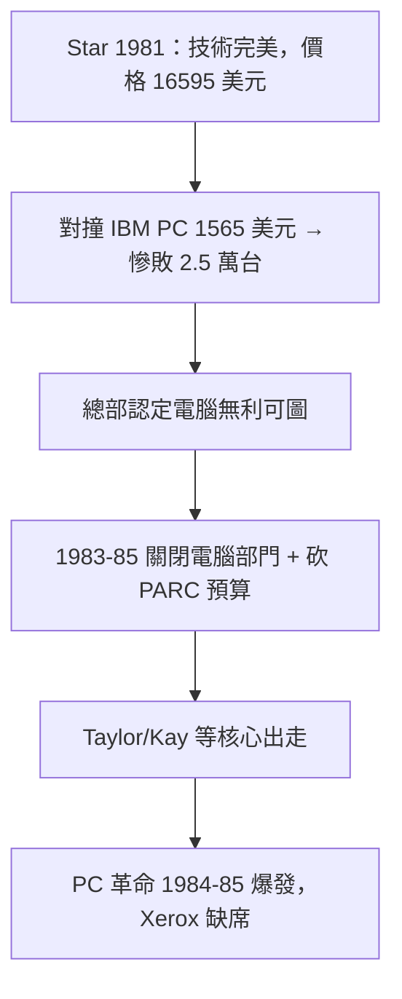

# 4.3 Xerox 電腦部門的關閉（1981-1985）

Xerox 並非完全沒給電腦機會。1981 年，公司推出 Alto 的正式商品 **Xerox Star（8010）**：完整的 GUI、工作站、乙太網路、雷射列印，系統之完整連今日眼光看都驚人。問題是價格與定位——單站 16595 美元、全套系統逾 10 萬美元，只賣給願意簽租賃合約的大企業。同期 IBM PC（1981）售價 1565 美元起、Apple II 更低，Star 在數量上毫無還手之力：總計僅售出約 2.5 萬台。

Star 滯銷後，總部迅速失去耐心。1983-1985 年，Xerox 關閉或收縮電腦系統部門（Xerox Computer Services 改組、SDS 早已出售給 Honeywell），PARC 預算被砍，研究員被要求「貼近影印本業」。Robert Taylor 1983 年出走，轉往 DEC 創辦 SRC 實驗室；Alan Kay 赴 Apple 任職；多數 CSL 骨幹四散。這條時間線與 PC 革命爆發期（IBM PC、Macintosh、Sun 工作站）完全重疊——Xerox 在黎明前夜關了燈。

更深層的因是組織地理與文化：三千公里的隔離曾保護創造力，此刻卻讓總部對 PARC 毫無信任；影印暴利（ $毛利率 > 60\%$ ）讓任何毛利較低的電腦生意都顯得「不值得」。Xerox 不缺技術、不缺人才，缺的是**容忍低毛利、高銷量新典範的勇氣**。

### 因果鏈
影印高毛利養高期望 → Star 沿用租賃高價邏輯 → 在 PC 低價洪流中慘敗 → 總部把模式失敗誤讀為技術失敗 → 關閉部門、自斷生路。Alto→Star→關閉是一條「用舊商業模式賣新典範」的自殺鏈。
