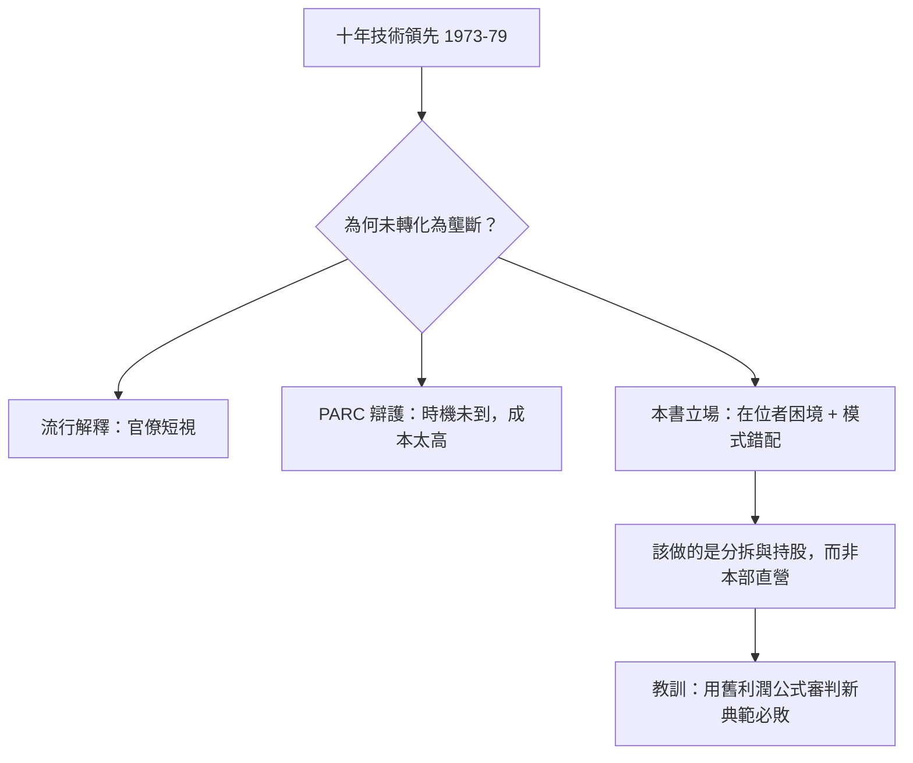

# 5.1 「錯失 PC 革命」的爭論（1985-）

「Xerox 錯失了 PC 革命」是最流行、也最需細辨的判語。一派（以《Dealers of Lightning》為代表）認為：Xerox 坐擁 Alto、GUI、乙太網路十年領先，卻因官僚與短視拱手讓人，是商學院經典反例。另一派（PARC 老人如 Lampson、Kay）反駁：把實驗室原型變成千美元商品，需要的成本下降、供應鏈與軟體生態在 1970 年代根本不存在；Xerox 若硬推 Alto，只會死得更慘——Star 的失敗就是證據。

公允的看法介於兩者之間：Xerox 真正錯失的不是「早十年賣 Mac」，而是**錯失用創投與分拆容忍新典範的機會**。它本可像培育雷射印表機那樣，允許 3Com 式、Adobe 式的子公司在體外長大，再以股權分享收穫。但 Xerox 堅持「一切收歸租賃制本部」，等於要求熱帶植物在寒帶開花。Jobs 的名言「Xerox 本可以擁有整個電腦產業」只對了一半——它本可以擁有「整個產業的股權」，而非「整個產業的產品線」。

這場爭論的價值在於把焦點從「誰抄誰」轉向「典範轉移時既有者在位者困境」： $利潤_{舊} \gg 利潤_{新}$ 時，理性經理人都會扼殺新事業。Xerox 不是笨，而是太理性。

### 因果鏈
技術領先是真 → 商品化時機未到也是真 → 真正的錯誤不在發明環節，而在組織設計環節（拒絕分拆）→ 兩種片面解釋各自捕捉一半真相 → 合起來才是完整的在位者困境。爭論本身推動了後來的開放創新理論。
