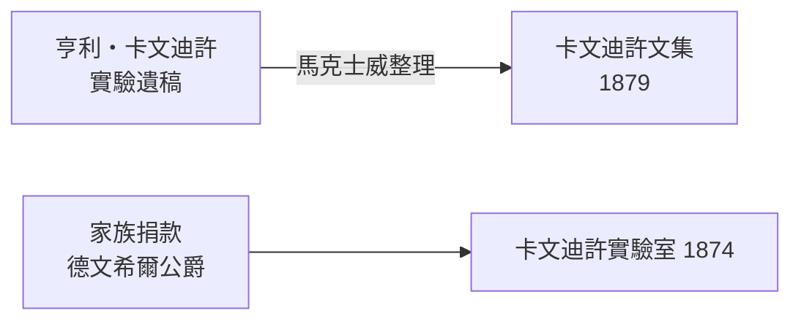

# 1.1 劍橋傳統與亨利・卡文迪許的遺產

## 一個「無實驗」的大學

19 世紀中葉的劍橋大學，以數學榮譽學位考試（Mathematical Tripos）為最高學術殿堂，物理被視為「自然哲學」，實驗則被貶為「工匠之事」。法拉第在倫敦皇家研究所演示電磁感應的年代，劍橋學生能背出牛頓《原理》的命題，卻幾乎沒有人摸過一台電流計。

然而兩股力量正在改變這一切：

1. **德國模式的挑戰**：李比希在吉森、亥姆霍茲在柏林建立了「教學實驗室」，科學研究與人才培養結為一體，德國化學與物理因此突飛猛進；
2. **英國本土的需求**：電報、海底電纜、電機工業興起，需要受過實驗訓練的物理學家，克拉克・馬克士威與開爾文男爵都參與過大西洋電纜工程。

## 亨利・卡文迪許：隱居的偉大實驗家

實驗室的名字來自 18 世紀的怪傑亨利・卡文迪許（Henry Cavendish, 1731–1810）：

- 發現氫氣（「可燃空氣」），並證明水是氫與氧的化合物（1784）；
- 用扭秤「稱量地球」，測出萬有引力常數 $G$ 與地球密度（1798）；
- 電學實驗超前時代半世紀——他量出了電容、電阻的雛形，卻終生幾乎不發表。

## 捐款與決策

1870 年，第七代德文希爾公爵（卡文迪許家族的姻親後裔，時任劍橋大學校長）捐款 6,300 英鎊興建實驗物理實驗室。為感念亨利・卡文迪許的科學遺產，實驗室以其命名。

**因果鏈**：德國教學實驗室的競爭壓力 → 英國科學界自省 → 劍橋接受捐款 → 決定聘任「實驗物理教授」→ 這把椅子落到了馬克士威身上。
