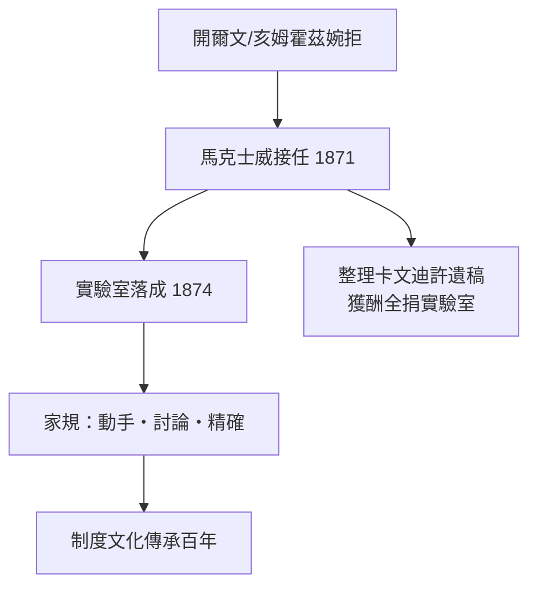

# 1.2 馬克士威與創建歲月（1871–1879）

## 群賢相讓

1871 年，首任卡文迪許教授遴選。候選人呼聲最高者包括開爾文與赫姆霍茲，二人都婉拒，並推薦馬克士威。馬克士威寫信自謙「此生未曾教過一堂化學或實驗物理課」，最終仍接下了這份工作。

## 艱難的創建

- **舊習阻力**：劍橋大學內部視實驗室為「把數學榮譽學位變成藍領作坊」的危險舉動；
- **經費拮据**：捐款僅夠蓋樓，設備不足，馬克士威自掏腰包添購儀器；
- **設計親力**：從教室到地下實驗桌的高度，他都親自規劃。

1874 年實驗室落成。馬克士威接受劍橋大學委託整理亨利・卡文迪許的遺稿（金額相當於他五年的薪資），他把這筆報酬全部投入實驗室，並於 1879 年編成《亨利・卡文迪許電學研究》——卡文迪許被埋沒的電學實驗，證明這位 18 世紀怪傑早已量出電容與電阻，只差「發表」二字。

## 學風奠基

馬克士威為實驗室立下三條家規，日後成為其百年靈魂：

1. **自己動手**：教授、講師、學生一律親自操作儀器；
2. **自由討論**：下午茶時間跨層級辯論，無人不可批評；
3. **簡陋不礙真理**：「用繩子、蠟與封印，也能做出精確量測」——精度靠頭腦，不靠裝備。

**因果**：正是「繩子、蠟與封印」的窮實驗傳統，訓練出了湯姆生、盧瑟福兩代人的量測本領——在設備豪華的德國實驗室之外，劍橋以「窮而巧」獨樹一幟。
