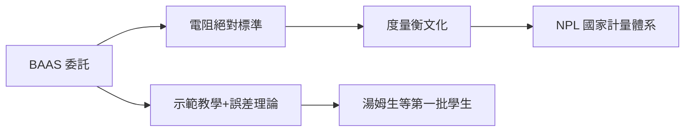

# 1.3 早期歲月：度量衡與第一批學生（1874–1879）

## 實驗室的「無用」年華

最初幾年，實驗室學生寥寥。馬克士威不急於出成果，而是把重心放在兩件「基礎工程」上。

## 電學標準的確立

英國科學促進會（BAAS）委託實驗室測定歐姆的絕對值。馬克士威與學生格拉斯布魯克（Fleming Jenkin, Chrystal）以轉動線圈法反覆量測，為電阻單位建立絕對標準。這項看似枯燥的工作意義深遠：

- 電報工程需要統一的電學單位；
- 「度量即科學」的信念深入實驗室文化；
- 這套標準化方法日後擴展到英國國家物理實驗室（NPL, 1900）。

## 《熱論》與教學

馬克士威在此寫下《熱論》（Theory of Heat, 1871，含「馬克士威妖」思想實驗），並開設實驗示範課，親自示範如何校準儀器、估算誤差——這在當時的英國大學是創舉。

## 第一批果實

馬克士威 1879 年 48 歲病逝。任內直接培養的人不多，但種子已播下：

| 人物 | 後來的發展 |
|---|---|
| J. J. 湯姆生 | 第二任卡文迪許教授，發現電子 |
| 約翰・霍普金森 | 電機工程先驅 |
| 亞瑟・舒斯特 | 曼徹斯特物理教授 |

**因果**：馬克士威五年的耕耘看似平淡，卻把「精確量測＋公開批評」的制度文化刻進實驗室。他一去世，這份遺產立刻面臨考驗——下一任主任能否守住並發揚它？
