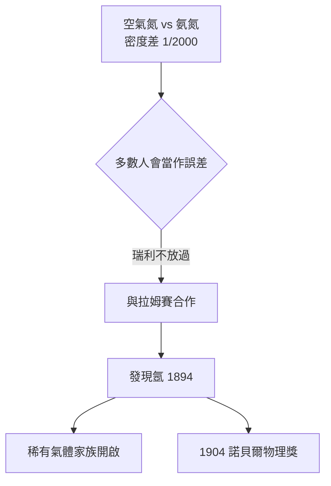

# 2.1 瑞利時代：氬的發現與制度化（1879–1884）

## 臨危受命

馬克士威 1879 年去世，實驗室前途未卜。瑞利男爵（Lord Rayleigh, John Strutt）接任第三任（實際上的第二任常任）卡文迪許教授。他本是一位擁有私人莊園與實驗室的貴族科學家，接任的理由很實際：他的私人實驗室太潮濕，影響精密量測。

## 五年的制度鞏固

瑞利任期不長（1879–1884），卻完成了關鍵的制度建設：

1. **正規化教學**：增設實驗課程與儀器更新基金，學生人數從寥寥數人增至約 70 人；
2. **教材建設**：編寫系統的實驗指導，取代馬克士威時代「因人施教」的做法；
3. **自己示範**：他親身證明實驗室教授也能做出一流研究。

## 意外的副產品：氬

瑞利在實驗室中比較「從空氣中取得的氮」與「從氨分解得到的氮」，發現前者密度恆定地重了約千分之 0.5。這微小到幾乎可以忽略的差異，被瑞利拒絕放過。與拉姆賽（William Ramsay）合作，1894 年他們發現了新元素**氬（argon）**，瑞利因此獲 1904 年諾貝爾物理學獎。

**因果**：「不接受不該有的小誤差」正是馬克士威誤差理論文化的直接產物。瑞利之後婉拒繼任、轉任皇家研究所，並推薦了年僅 28 歲的 J. J. 湯姆生——這一步把實驗室推向了原子革命。
