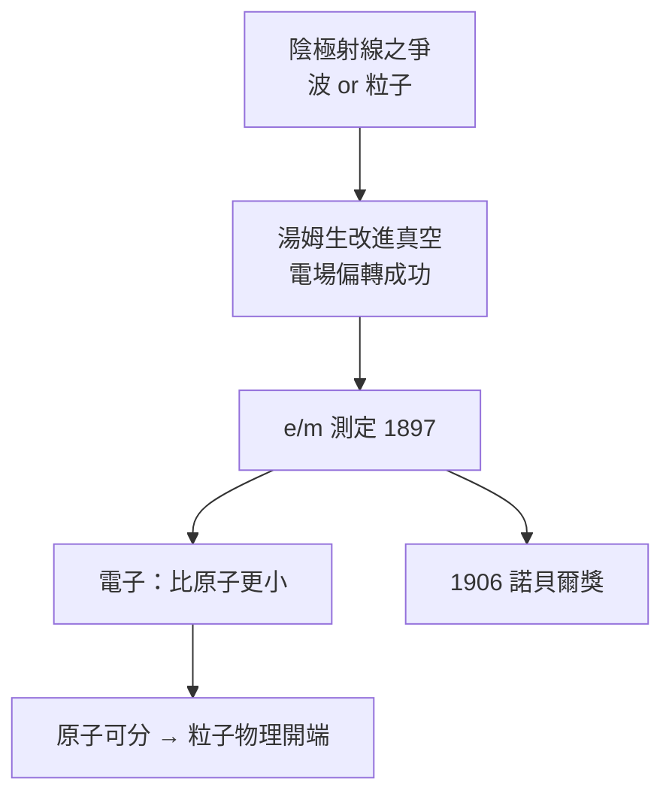

# 2.2 J. J. 湯姆生與電子的發現（1884–1897）

## 28 歲的年輕教授

1884 年瑞利離任，遴選委員會在 28 歲的 J. J. 湯姆生與較年長的舒斯特之間選擇。湯姆生是出色的數學家、實驗本領平平——他自己承認手笨，靠著技工理查森（E. Everett）與後來的技工惠德頓（W. G. Pye）代為操作。但他的最大天賦是**識人與放手**：他知道問題在哪，讓會動手的人去做。

## 陰極射線之謎

1890 年代，陰極射線的本質是德英兩派之爭：

- 德國學派（赫茲、倫納德）：是一種波（以太波）；
- 英國學派（克魯克斯等）：是帶電粒子流。

爭論的焦點在於能否量出**荷質比 $e/m$**。

## 1897 年：原子分裂了

湯姆生的策略是「窮人的辦法」：用電場與磁場同時偏轉射線，聯立求出速度 $v$ 與荷質比：

$$\frac{e}{m} = \frac{E}{B^2 r}$$

三項關鍵實驗（1897 年 4–10 月）給出決定性結論：

1. 射線能被靜電場偏轉（赫茲當年失敗，因管內真空不足）；
2. 荷質比約為氫離子的 **1000 倍以上**，且與電極材料、氣體種類**無關**；
3. 這種粒子存在於一切物質之中。

結論：存在一種比原子更小的帶電粒子——**電子**。原子不是不可分的。湯姆生獲 1906 年諾貝爾物理學獎。

**因果**：馬克士威的電磁理論提供了偏轉計算的框架，瑞利建立的教學規模培養了學生，湯姆生的「識人善任」讓窮設備發揮極致。電子的發現把卡文迪許從「度量衡實驗室」變成「原子物理聖地」，並為下一任主任盧瑟福的登場鋪平了道路。
