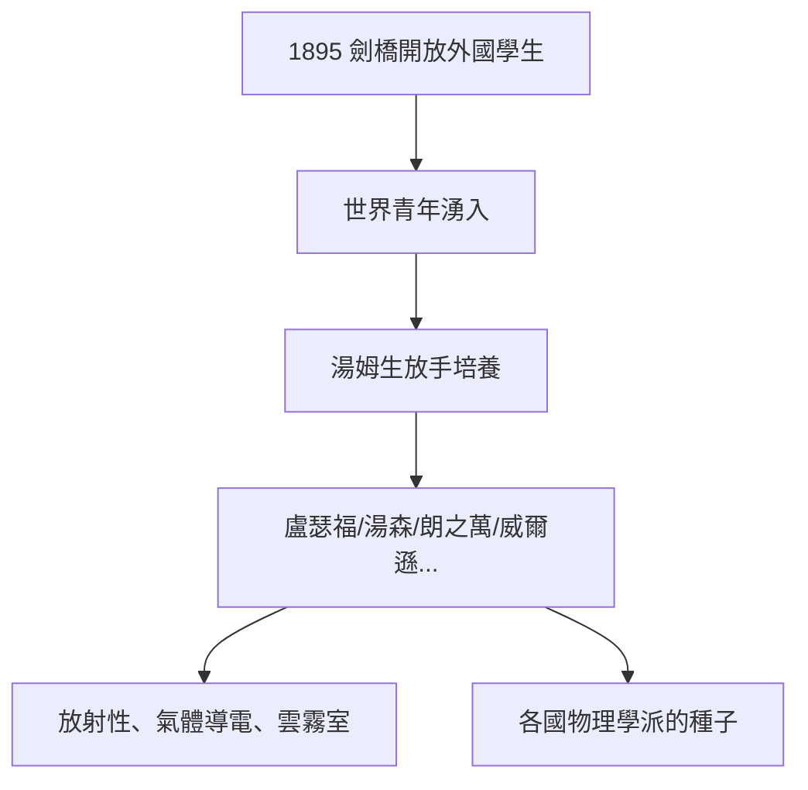

# 2.3 湯姆生的學生時代：世界來到劍橋（1895–1914）

## 制度革命的起點：女性與外國人入學

1895 年，劍橋大學允許外校畢業生（包括女性與外國人）前來攻讀高等學位。對卡文迪許實驗室而言，這是一條改變世界的規則——湯姆生立刻大量招收外國學生。

## 群星雲集

| 年代 | 學生 | 來自 | 後來的貢獻 |
|---|---|---|---|
| 1895 | 盧瑟福 | 紐西蘭 | 原子核、放射性、第 4 任教授 |
| 1895 | 湯森 | 愛爾蘭 | 電荷量測、氣體導電 |
| 1898 | 朗之萬 | 法國 | 磁性理論、超聲波 |
| 1899 | 麥克拉倫、麥克拉倫夫人等 | 加拿大 | 加拿大物理學派 |
| 1900s | 威爾遜 | 蘇格蘭 | 雲霧室（1927 諾獎） |

日本、德國、波蘭、印度（拉曼曾來訪）……一時之間，實驗室成了「世界的物理學院」。

## 教學相長的方法

湯姆生的辦法延續馬克士威家規，但更有組織：

- **研討班**：每週討論最新文獻，學生輪流報告；
- **讓學生做「新」問題**：他自己主管大方向，具體課題放給學生闖；
- **群體效應**：學生之間互相批評、互相學習，知識在走廊與茶會中流動。

**因果**：如果沒有 1895 年的入學開放，就沒有盧瑟福來到劍橋；沒有盧瑟福，就沒有原子核，也可能沒有後來卡文迪許的黃金三十年。一次招生制度的改變，改寫了 20 世紀物理學的版圖。
