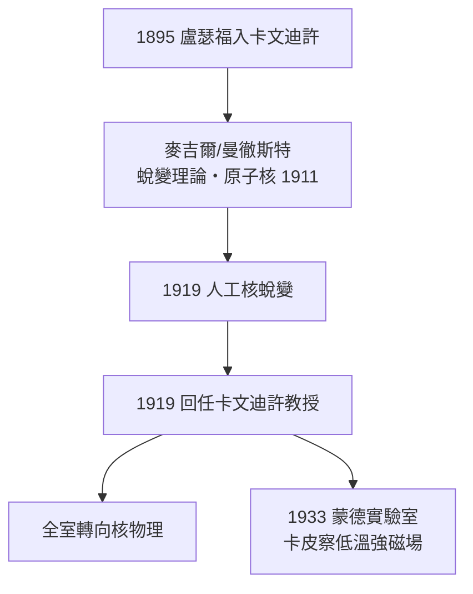

# 3.1 盧瑟福接掌：把「打原子」帶回母校（1919）

## 從紐西蘭學生到主任

盧瑟福（Ernest Rutherford）1895 年作為外校生進入卡文迪許，師從湯姆生研究無線電波。1898 年赴蒙特婁麥吉爾大學，發現釷的放射性衰變並提出**蛻變理論**（與索迪，1902）；1907 年轉曼徹斯特，1911 年以 $\alpha$ 粒子散射實驗提出**原子核模型**，1919 年用 $\alpha$ 粒子轟擊氮，實現**人類第一次人工核蛻變**。

同年，湯姆生當選三一學院院長，辭去卡文迪許教授。盧瑟福受邀回母校接任第四任教授。

## 一位「君主式」的科學家

與湯姆生的「放手」相反，盧瑟福是強勢的家長：

- **大嗓門與口號**：「他們在玩雕刻，我們在打開原子的門」；
- **抓住中心課題**：全室圍繞核物理，其他課題靠邊站；
- **親自盯進度**：每天巡視實驗桌，一句「我看你還沒什麼進展」讓學生徹夜工作；
- **偶爾偉大的直覺**：他可以否決錯誤的數據，也會憑直覺否決別人的論文（他對達令與福勒關於氫譜的修正建議，成就了量子力學的一個經驗支柱）。

## 蒙德實驗室

1932–33 年，盧瑟福為蘇聯流亡物理學家**卡皮察**（Pyotr Kapitsa）在自由學校巷新建**蒙德實驗室**（Mond Lab），專攻強磁場與低溫物理。這顯示他雖然專斷，卻也懂得為傑出人才專門造樓——卡文迪許的規模第一次擴張。

**因果**：電子的發現（湯姆生）開啟了「原子可分」的時代，盧瑟福則把「撬開原子核」定為全室任務。接下來十年，中子與人工核分裂將在這裡接連誕生。
